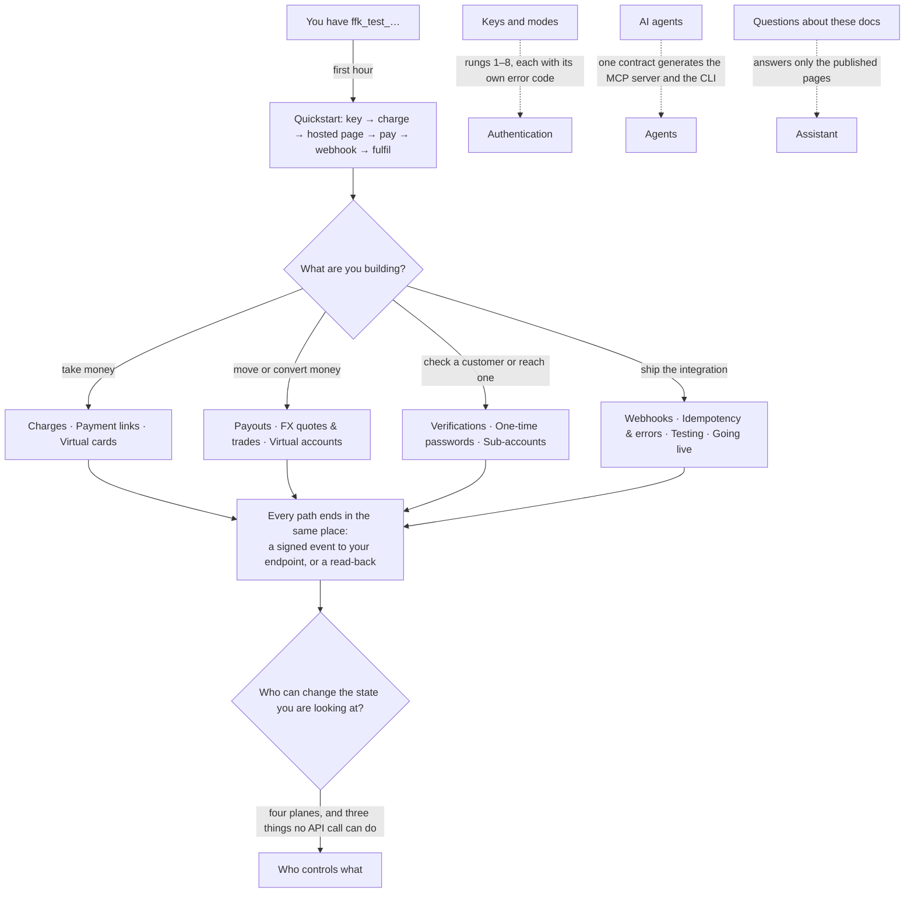

# FirstFlip Developers

Accept crypto from anyone, anywhere, and receive it in your own bank in your own currency. You never
hold or manage crypto. This repo is the public contract for the FirstFlip API: the reference, the
guides and the Postman collection.

> **Status: beta, test mode.** Test keys (`ffk_test_…`) work end to end in the sandbox, where payments
> are simulated and no money moves. Live keys are not issued yet. When live mode opens, your
> integration does not change: same endpoints, same objects, same webhooks.

## Download this beta

The MCP server, CLI and portable integration skill are available from the [beta release](https://github.com/firstflipapp-del/firstflip-api/releases/tag/v0.1.0-beta.2). npm and MCP Registry listings are separate publication steps; use the downloadable package while those listings are pending.

Run the MCP process with Node.js 18 or newer:

```bash
npx --yes --package https://github.com/firstflipapp-del/firstflip-api/releases/download/v0.1.0-beta.2/firstflip-agents-0.1.0-beta.2.tgz firstflip-mcp
```

Set `FIRSTFLIP_SECRET_KEY` through your MCP client's secure environment configuration. The CLI is `firstflip` from the same package; the skill ZIP contains the complete `firstflip-integration` directory and its references. The release does not enable live payment services: key mode, business verification, scopes and each service's readiness still apply.

## Quick hints

Short points that hold on every page — the things that cost the most support time.

1. **`amount` is in major units everywhere.** `32000` is ₦32,000, `20.5` is $20.50. Minor units is how a ₦500 order becomes a ₦50,000 one.
2. **Every POST needs an `Idempotency-Key`** (`POST /v1/assistant` is the one exception). A missing header is `400 idempotency_key_required` and fires before your body is read; the same key with the same body replays the original result; the same key with a different body is `422 idempotency_key_reused`; a key still in flight is `409 idempotency_in_progress`, so retry it.
3. **Limits are in the response, not in your head.** Page until `has_more` is `false`, pass `Retry-After` on a `429`, drive expiry from `expires_at`, read prices from `GET /v1/otps/pricing`. 60 writes and 300 reads per key per minute is the current shape of the first two.
4. **Fulfil from the event or the read-back, never from the browser.** `charge.paid` via webhook, or `GET /v1/charges/:id`. A customer returning to your site proves nothing.
5. **On a `card.*` event, fetch the card.** The contract publishes 28 event names but no card payload schema yet, so the event tells you *what happened*, and `GET /v1/cards/:id` tells you the state.
6. **Three things no API call can do:** change your payout bank account, register a webhook endpoint, or issue and rotate keys. [Who controls what](guides/who-controls-what.md) draws the four planes that actually decide your state.
7. **Two 403s are not your code.** `business_inactive` and `api_access_paused` are decisions made above your key; no change you push clears them.
8. **Cards promote leg by leg.** A live key can already `list`, `get`, `freeze` and `unfreeze`; the six money legs answer `403 live_precondition_unmet` with the missing rail in `error.param`, and only `simulate_authorization` still answers `403 live_mode_unavailable`. No switch, no waitlist — see [Live legs](guides/cards.md#live-legs).
9. **The contract is served by the API itself.** `https://api.firstflip.ng/docs/openapi.yaml` and `https://api.firstflip.ng/docs/api/services.openapi.json` come from the host you are calling, and the MCP server, the CLI and the reference are all generated from them.

## Start here

| | |
|---|---|
| [Quickstart](guides/quickstart.md) | From a key to a paid test charge in 5 minutes |
| [Authentication](guides/authentication.md) | Keys, modes, IP allow-lists, rotation |
| [Who controls what](guides/who-controls-what.md) | The four planes that can change your state — and the three things no API call can do |
| [Charges](guides/charges.md) | Amounts, assets, networks, statuses, expiry |
| [Payment links](guides/payment-links.md) | One shareable link, a separate charge per customer |
| [Sub-accounts](guides/subaccounts.md) | Your end-users as tenants: create, list, suspend, activate |
| [Virtual cards](guides/cards.md) | Sandbox USD cards: issue, fund, freeze, cap, simulate a swipe, reconcile — and every decline code |
| [Payouts](guides/payouts.md) | Test transfers and bulk payouts: corridors, amounts, list and reconcile, simulate, retry |
| [Webhooks](guides/webhooks.md) | Events, signatures (Node, Python, PHP), retries |
| [Idempotency & errors](guides/idempotency-and-errors.md) | Safe retries, error codes, rate limits |
| [Testing](guides/testing.md) | The sandbox, simulated payments, test checklist |
| [Going live](guides/going-live.md) | What changes, and the go-live checklist |
| [API reference](openapi.yaml) | OpenAPI 3.1, the source of truth ([rendered](reference/index.html)) |
| [Postman](postman/) | Import the collection + environment, set `secretKey`, run |
| [Node.js SDK](sdks/node/) | `@firstflip/node`: typed client, safe retries, webhook verification |
| [AI agents (MCP + CLI)](guides/agents.md) | `@firstflip/agents`: stdio MCP server and CLI, generated from the contract |
| [Assistant](guides/assistant.md) | `POST /v1/assistant {"question": "…"}` answers from these docs only (also in Postman → Assistant) |
| [AI discovery](llms.txt) | A compact LLM index, [full guide context](llms-full.txt), and the [capability manifest](.well-known/firstflip-integration.json) |
| [Integration skill](skills/firstflip-integration/SKILL.md) | Portable FirstFlip integration instructions with the complete public contract and guide bundle |
| [Roadmap](ROADMAP.md) | What is coming to the API |
| [Changelog](CHANGELOG.md) | Every change to the contract |

Both contract files are also served by the API itself, so a tool or an agent can fetch them from the host it is
calling instead of from this repository: `https://api.firstflip.ng/docs/openapi.yaml` and
`https://api.firstflip.ng/docs/api/services.openapi.json`. The service file sits at the path the main spec's
relative `$ref`s already point at, so the fetched YAML resolves against the same host with no bundling step.
Both answers are cacheable for five minutes and revalidate with `ETag` (`304` on a match).

## How to read this surface

Three questions decide the route through these pages. Everything hangs off one contract, and every page's
claims are checked against it by `npm run check`.



Read [Who controls what](guides/who-controls-what.md) before you design anything that depends on state you
do not own: it separates what the API moves, what the business panel moves, what the admin desk moves, and
what only FirstFlip staff can change.

## Business services

Alongside charges, the API ships provider-backed services on the same keys and the same rules. They have their
own contract file, [`api/services.openapi.json`](api/services.openapi.json), and their own Postman collection,
[`api/services.postman_collection.json`](api/services.postman_collection.json). Every one is test mode only:
records are created, observations are simulated, and no money moves.

| | |
|---|---|
| [FX quotes & trades](guides/fx.md) | Synthetic rates, quote → trade, every failure your code must handle |
| [Virtual accounts](guides/virtual-accounts.md) | Test account numbers: static vs dynamic, payments, bulk, lifetime |
| [Verifications](guides/verifications.md) | BVN consent flow and bank-account resolution |
| [One-time passwords](guides/one-time-passwords.md) | OTP as a service: pricing, create, validate, attempts |
| [Payouts](guides/payouts.md) | Transfers and bulk payouts to banks, mobile money and wallets |

## At a glance

```bash
curl https://api.firstflip.ng/v1/charges \
  -H "Authorization: Bearer $FIRSTFLIP_SECRET_KEY" \
  -H "Idempotency-Key: $(uuidgen)" \
  -H "Content-Type: application/json" \
  -d '{"amount": 32000, "currency": "NGN", "reference": "order_1042"}'
```

You get back a `charge` with a crypto quote and a `hosted_url`. Send your customer there. When they
pay, we `POST` a signed `charge.paid` event to your webhook endpoint.

## Maintaining this repo

`openapi.yaml` is the only hand-written source for the contract. Everything else is generated from it:

```bash
npm install
npm run build     # lint the spec, regenerate postman/, reference/, assistant/ and agents/tools.json
npm run check     # CI: fails if a generated file is stale, if a guide says something the contract does not,
                  # or if the typed client's decline codes drift from the spec (the SDK suite runs here too)
npm run test:sdk  # 31 client tests: request building, retries, webhook signing, and the index.d.ts ⇄ spec pins
npm run test:agents  # the MCP server and CLI tests (53 tools, request building, JSON-RPC, stdio)
```

Change the spec in the same pull request as the server change, and add a line to the changelog.
Within `v1`, changes are additive only; a breaking change means `/v2`.

## Licence

The Node.js SDK (`sdks/`) and the code samples are MIT. The docs are © First Flip Ltd, all rights
reserved: you may read them and use them to integrate with the FirstFlip API. See [LICENSE](LICENSE).
