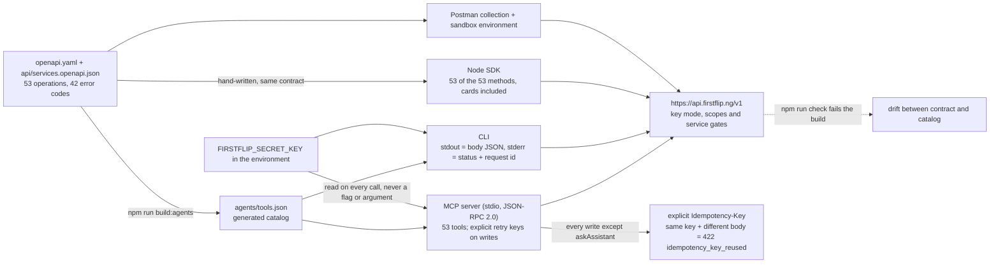

# FirstFlip for AI coding agents

The FirstFlip API is built to be called by AI coding agents, not just humans reading docs. Everything
in this guide is the same surface the Node.js SDK and the Postman collection cover — the contract in
[`openapi.yaml`](../openapi.yaml) is the only source of truth, and the MCP server and the CLI are
both generated from it.

> **Start with a test key.** Test keys simulate supported operations. A live key is subject to
> business verification, scopes and the live prerequisites of each operation. This connector does
> not enable a live rail. Read the relevant product guide before using a live key.

## Quick hints

Short points that matter more than the paragraphs below them.

1. **One contract, three surfaces.** `openapi.yaml` generates `agents/tools.json`, and the MCP server and the CLI are both built from that catalog — so an agent cannot call a path the contract does not publish. `npm run build:agents` regenerates it and `npm run check` fails the build on drift.
2. **All three surfaces carry the card routes.** All 53 `/v1` operations are here, including the 11 `card` tools; the Node SDK has a typed method for every one of them.
3. **The annotations cover both modes.** Reads carry `readOnlyHint: true`; writes carry a conservative `destructiveHint: true` because they can change business data. The API still decides which live operations are available.
4. **MCP writes require a stable retry key.** Every write except `askAssistant` requires an explicit `idempotency_key`. Save it before calling and reuse it with identical arguments after a timeout. The CLI generates a key if omitted and prints it to stderr.
5. **The key is read from the environment on every call.** Rotate it without restarting the server; it is never a flag, never a tool argument, never a log line, and `ffk_test_REPLACE_ME` still returns `401 invalid_api_key`.
6. **A key pasted into a prompt is already exposed.** Say so first, then rotate — that is a rule for the agent too.
7. **Pipe stdout, not stderr.** The response body JSON goes to stdout; the status line and request id go to stderr. Exit `0` is 2xx, `1` is an API or network error, `2` is a usage or config error.
8. **Reuse the operation key on retries.** Pass `idempotency_key` (MCP) or `--idempotency-key` (CLI); the same key with a different body is `422 idempotency_key_reused`. Tool results return the key even on network failure.
9. **Pay pages are not tools.** `/sandbox/pay/:token` and `/sandbox/l/:token` return HTML; hand the customer the `hosted_url` from a charge or payment-link response instead.
10. **Webhooks are inbound.** Verify the raw bytes and deduplicate the event before fulfilment; a browser redirect is not payment confirmation. The contract publishes the event catalog and payload schemas.
11. **Money-out stays guarded.** Transfers, payouts and FX trades appear in the catalog as simulations; the step-up / PIN guard for live money-out is not weakened by this package.

## One contract, and why an agent cannot drift from it

Every surface below is a *derived* artifact. That is the whole safety argument: a tool that calls an
undocumented path cannot be built, because the generator has no such path to emit.



`askAssistant` is the single write that takes no key of its own — it is a question, not a record. Everything
else that can create a row requires a stable key in MCP, so an agent can retry a call whose result was lost
without creating another operation.

## What is shipped

| Package | What it is | Where |
|---|---|---|
| `@firstflip/agents` | A zero-dependency stdio MCP server + a zero-dependency CLI, both generated from the contract. | `agents/` |
| `@firstflip/node` | The typed Node.js client (one method per API-key operation — **53 of the 53** — with safe retries and webhook verification). The 11 virtual-card routes are `firstflip.cards.*` here too. | `sdks/node/` |
| Postman collection + environment | One-click import, environment variable for the key, a walkthrough. | `postman/` |

The MCP server and the CLI share one generated catalog, `agents/tools.json`. That file is the
contract in agent-friendly shape: every tool's name, description, input schema and scope are
derived from `openapi.yaml` + `api/services.openapi.json`. A tool that calls a path the contract
does not publish cannot exist — the catalog is regenerated by `npm run build:agents` and the
`check` script fails the build if it drifts.

## The MCP server

A stdio MCP server (JSON-RPC 2.0, newline-delimited) that exposes the 53 API-key operations as
tools — the published `/v1` surface a key can call, including all 11 card routes and their Node SDK
methods. Every tool carries the scope it needs (`x-required-scope`), a full
description, a JSON Schema input, and honest annotations:

- `readOnlyHint` is `true` for `GET` operations, `false` for writes.
- `idempotentHint` is `true` for keyed writes; `idempotency_key` is required for the same logical request.
- `destructiveHint` is conservatively `true` for writes and `false` for reads, across both key modes.

### Configuration (environment)

| Variable | Required | Default |
|---|---|---|
| `FIRSTFLIP_SECRET_KEY` | yes, to call a tool | — |
| `FIRSTFLIP_BASE_URL` | no | `https://api.firstflip.ng/v1` |
| `FIRSTFLIP_TIMEOUT_MS` | no | `30000` |

The key is read from the environment on every call, so rotating it does not need a server restart.
The key is never logged, never echoed in an error, never accepted as a tool argument.

### Claude Code

Add to your project's `.mcp.json`:

```json
{
  "mcpServers": {
    "firstflip": {
      "command": "node",
      "args": ["node_modules/@firstflip/agents/mcp-server.js"],
      "env": {
        "FIRSTFLIP_SECRET_KEY": "ffk_test_…"
      }
    }
  }
}
```

### Codex

Add to your `config.toml`:

```toml
[mcp_servers.firstflip]
command = "node"
args = ["node_modules/@firstflip/agents/mcp-server.js"]
env = { FIRSTFLIP_SECRET_KEY = "ffk_test_…" }
```

### Generic stdio client

Any MCP client that speaks JSON-RPC 2.0 over stdio (newline-delimited) works: spawn the server,
send `{"jsonrpc":"2.0","id":1,"method":"initialize","params":{"protocolVersion":"2025-11-25"}}`,
then `tools/list` and `tools/call`.

Supported protocol versions are `2025-11-25`, `2025-06-18`, `2025-03-26` and `2024-11-05`.
An unknown requested version receives the newest supported version, so the client can disconnect
if it does not support that version. Tool calls need a request ID; notifications never execute a tool.

## The CLI

```bash
export FIRSTFLIP_SECRET_KEY=ffk_test_…
firstflip list                              # every operation: name, method, path, scope
firstflip describe createCharge             # full schema + a published example body
firstflip call createCharge --body '{"amount":25000,"currency":"NGN"}'
firstflip getCharge --id ch_…               # bare operation name works too
```

Flags for a call:

- `--<param> <value>` — path or query parameter (`--id`, `--limit`, `--status`, …).
- `--body '<json>'` or `--body-file <path>` (or `-` for stdin) — the request body.
- `--idempotency-key <k>` — reuse a key to retry the same logical write safely.
- `--base-url <url>` — override the sandbox base (https only, except localhost).
- `--timeout-ms <n>` — request timeout.

Output is machine-readable: the response body JSON on stdout (pipeable), the status line and the
request id and write's `idempotency_key` on stderr. Exit codes: `0` for 2xx, `1` for an API/network error, `2` for a
usage/config error.

## The safety rules (enforced, not aspirational)

1. **The key never leaves the environment.** It is not a flag, not a tool argument, not a log line.
   A key pasted into chat is exposed — say so first, then rotate.
2. **Mode comes from the key.** Test keys simulate supported operations. Live keys still pass the
   API's verification, scopes, account controls and operation-specific service gates. The connector
   does not bypass those gates or promise that every operation is live.
3. **Retries keep the same operation.** MCP requires an explicit `idempotency_key` for writes.
   The CLI can generate one and prints it. Save and reuse it with identical arguments after an
   ambiguous result. The same key with a different body is rejected (`422 idempotency_key_reused`).
4. **The contract is the only source of truth.** The catalog is generated from `openapi.yaml`;
   the MCP server and the CLI cannot call a path the contract does not publish.
5. **Errors are canonical.** Every failure comes back with the same shape
   (`{error:{type,code,message,param}}`) and the same machine-readable codes. The CLI prints
   them; the MCP server returns them as `isError: true` with the full payload.

## When something fails

| HTTP | Code | What it means |
|---|---|---|
| `401` | `invalid_api_key` | The key is wrong, revoked, or still `ffk_test_REPLACE_ME`. |
| `401` | `key_expired` | The key is real but past its expiry date. Mint a successor — this is not a breach. |
| `403` | `insufficient_scope` | The key lacks the scope the operation needs. Mint a new key with the right scope. |
| `403` | `live_mode_unavailable` | You used a live key on a surface whose live rails are not open (or on the card authorization simulator, which is test-only by design). Use `ffk_test_…`. |
| `403` | `live_precondition_unmet` | A live card leg is waiting on a named platform rail and `error.param` says which one. Nothing was changed and no money moved. |
| `404` | `not_found` | The resource does not exist (or the Developer API is not switched on). |
| `409` | `duplicate_reference` | A charge with that `reference` already exists. |
| `422` | `idempotency_key_reused` | You reused an `Idempotency-Key` with a different body. |
| `429` | `rate_limited` | Back off; honor `Retry-After` (seconds). |
| `503` | `service_unavailable` | Retry with the same `Idempotency-Key` after `Retry-After`. |

## What is NOT in this package

- **Money-out paths** (transfers, payouts, FX trades) are in the catalog, but they are
  **simulated** in test mode. The server's step-up / PIN guard for live money-out is unchanged
  and is not weakened by this package.
- **Hosted pay / landing pages** (`/sandbox/pay/:token`, `/sandbox/l/:token`) are browser
  endpoints. They return HTML, not JSON, and are not exposed as agent tools. The `hosted_url`
  in a charge or payment-link response is what you hand to the customer.
- **Webhooks** are inbound, not requests. The contract publishes the event catalog and the
  signature algorithm; this package does not need to call webhooks.
- **Airtime, gift-card sales and gadget-store orders** are not operations in this published catalog.
  Their presence in a consumer app does not make them available to business API keys.

## Discovery and portable skill

The public documentation includes [llms.txt](../llms.txt), [full guide context](../llms-full.txt),
a [machine-readable capability manifest](../.well-known/firstflip-integration.json) and the
[FirstFlip integration skill](../skills/firstflip-integration/SKILL.md). The skill includes the same
contracts, tool catalog and guide bundle, with source fingerprints, and is also included under
`node_modules/@firstflip/agents/skills/firstflip-integration` in the npm package.

These are public integration resources. A caller still needs their own business API key; installation
does not create an account, approve KYC/KYB or switch on a live capability. This package exposes a local
stdio process, not an unauthenticated remote HTTP endpoint.
