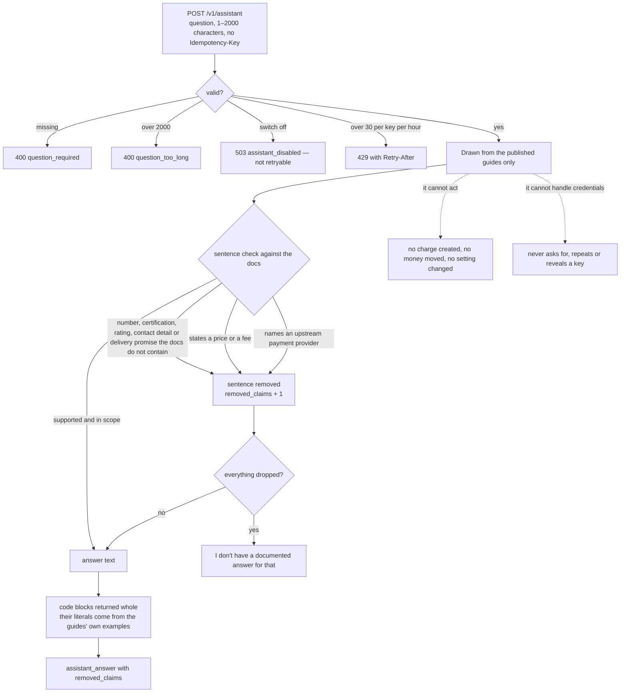

# Assistant

`POST /v1/assistant` answers integration questions from this documentation. It is the same knowledge
base the guides are built from, so an answer can never be more current, or more generous, than the page
you are reading.

It has its own cap — 30 questions per key per hour — and takes no `Idempotency-Key`. It needs the
`assistant:ask` scope.

## Quick hints

Short points that matter more than the paragraphs below them.

1. **It is switched off by default during the beta.** `503 assistant_disabled` is not retryable and blocks nothing else — the guides and every other endpoint keep working.
2. **A price never comes out of it.** Sentences stating a price or a fee are dropped even when the docs support them; read amounts from `GET /v1/otps/pricing` or the guide's own table.
3. **So is the name of an upstream provider.** The rails FirstFlip settles through never become chat copy.
4. **Check `removed_claims` before you trust the prose.** It counts sentences dropped for numbers the docs do not contain; when everything is dropped you get the documented "no documented answer" line instead.
5. **Code blocks arrive whole.** Their literals come from the guides' own examples, so a snippet is as safe as the page it was copied from.
6. **It cannot do anything.** No charge created, no money moved, no setting changed — it answers and points at the guide that explains the operation.
7. **Never put a credential in the question.** It will not ask for one, will not repeat one, and will not reveal one.
8. **`Idempotency-Key` is not taken here.** The cap is instead 30 questions per key per hour; a `429` tells you how long to wait with `Retry-After`.
9. **2,000 characters, and not empty.** Over that is `400 question_too_long`; missing is `400 question_required`.
10. **Ask one thing and name the endpoint.** "Which parameter makes a charge expire?" beats "explain everything" — the answer can cite the exact rule when the question has a subject.

## What happens to your question

Every sentence is checked before it reaches you, and two categories are dropped even when the guides support
them. `removed_claims` is the count of what fell out.



Read `removed_claims` as a liveness signal for the docs behind the answer: a nonzero count means the assistant
found something to say that the published pages do not support, and the safe move is to trust the page.

```bash
curl https://api.firstflip.ng/v1/assistant \
  -H "Authorization: Bearer $FIRSTFLIP_SECRET_KEY" \
  -H "Content-Type: application/json" \
  -d '{ "question": "How do I verify a FirstFlip-Signature?" }'
```

```json
{
  "object": "assistant_answer",
  "answer": "Recompute HMAC-SHA256 over \"<t>.<raw body>\" with the endpoint's signing secret, compare in constant time, and reject a timestamp older than 5 minutes. See the Webhooks guide for the check.",
  "removed_claims": 0
}
```

## What it will and will not do

- It answers from the published guides only. If the docs don't cover it, it says so instead of guessing:
  *"I don't have a documented answer for that. Check the guides, or ask FirstFlip support."*
- Every sentence is checked against the docs before it reaches you. One whose numbers, percentages,
  certifications, ratings, contact details or delivery promises the docs don't contain is removed.
  `removed_claims` counts the sentences dropped. If everything is dropped you get the "I don't have a
  documented answer" line. Code blocks are returned whole, because their literals come from the docs'
  own examples.
- Two kinds of sentence are dropped **even when the docs support them**: one that states a price or a
  fee, and one that names an upstream payment provider. It cannot quote a price even if you ask one
  directly; read amounts from `GET /v1/otps/pricing` or the guide's table. This is deliberate: a chat
  that can't state a price can't misquote one, and the rails we settle through never become public
  copy.
- It never asks for, repeats or reveals an API key, webhook secret or other credential. Keep keys on
  your server.
- It cannot act: it cannot create a charge, move money or change a setting. It answers and points at the
  guide that does.

## Limits and errors

| HTTP | `code` | Meaning |
|---|---|---|
| 400 | `question_required` | `question` was empty or missing |
| 400 | `question_too_long` | Over 2000 characters |
| 429 | `rate_limited` | Over 30 questions this hour; wait `Retry-After` |
| 503 | `assistant_disabled` | The assistant is switched off for this environment (not retryable) |
| 503 | `assistant_unavailable` | Briefly unavailable (retryable) |

The assistant is off by default during the beta. A `503 assistant_disabled` means the docs are still
readable and every other endpoint works; only the chat is switched off.

## Asking well

- Ask about one thing at a time: *"Which parameter sets a charge to expire?"* beats *"explain
  everything"*.
- Name the endpoint or field you are working with, so the answer can cite the exact rule.
- Ask for a language you use; Node.js with `fetch` is the default.

## With the Node SDK

```js
const answer = await firstflip.assistant.ask('How do I verify a FirstFlip-Signature?');
console.log(answer.answer);
```

## Keep your own assistant grounded the same way

The guides are plain markdown on purpose: if you build your own support assistant, feed it these pages
(and `assistant/knowledge.md`, the generated bundle behind this endpoint) rather than a summary. The
grounding rule above — drop any sentence whose numbers the source doesn't contain — is the part that
stops a chat from inventing a fee.
