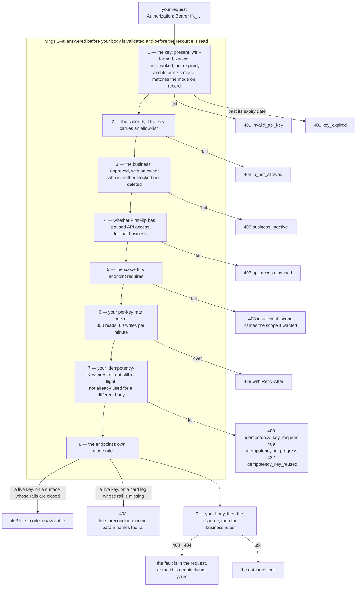

# Authentication

Every request carries your **secret key** as a bearer token:

```http
Authorization: Bearer ffk_test_7c1e…
```

## Quick hints

1. **The prefix is the mode.** Same host, same paths, same shapes. `ffk_test_` is sandbox-only and `ffk_live_` is real; there is no test URL to forget to switch.
2. **An empty scope list is the widest key you have.** It is not "no permissions" — it means every scope the mode allows. Re-mint least-privilege before you ship.
3. **Scopes never widen after creation.** To change what a key can do, issue a new one and revoke the old.
4. **A key is your business's signature.** Server-side only — env var or secrets manager. Never in a mobile app, browser code, a public repo or a support ticket. If it leaks, revoke first and rotate after.
5. **We cannot read your key back.** Only a one-way hash is stored, so a lost key is a new key, and no FirstFlip staff can retrieve one for you.
6. **Up to 5 active keys per mode** — enough for `web-prod`, `worker` and a staging key with room to rotate. Name keys by where they run so you know what breaks when you revoke one.
7. **A `403` is not a lookup.** Everything above rung 9 in the ladder below is answered before the resource is read, so `403` never tells you an id exists and `404` always means you got a real answer.
8. **`insufficient_scope` names the scope it wanted**, and each operation carries it as `x-required-scope` — read it off the reference instead of guessing which key fits.


## Keys and modes

| Prefix | Mode | What it can do |
|---|---|---|
| `ffk_test_` | Test | Sandbox only. Simulated payments, no money moves. |
| `ffk_live_` | Live | Real charges. Not issued during the beta. |

The key decides the mode; there is no separate test host. A test key can never see live data and a live
key can never see test data. Every object says which it is (`livemode`, and ids like `ch_test_…`).

## Scopes

A key can be restricted to the parts of the API it needs. A key created **without** a scope list — including
every key that predates scopes — can do everything its mode allows. A key's scopes are never widened after
creation; rotate the key to change them. Each endpoint checks exactly one scope:

| Scope | Covers |
|---|---|
| `account:read` | `GET /v1/account` |
| `charges:read` / `charges:write` | list and retrieve charges / create, cancel, simulate payment |
| `payment_links:read` / `payment_links:write` | list and retrieve links / create, deactivate |
| `subaccounts:read` / `subaccounts:write` | list and retrieve sub-accounts / create, suspend, activate |
| `cards:read` / `cards:write` | list and retrieve cards and their transactions / create, fund, withdraw, freeze, unfreeze, close, set spend limits, simulate an authorization. A live key is answered **per leg**, not all-or-nothing: four legs run, six answer `403 live_precondition_unmet`, and only the simulator still answers `403 live_mode_unavailable` — see [Virtual cards](cards.md) |
| `otps:read` / `otps:write` | OTP pricing and lookup / create, validate |
| `fx:read` / `fx:write` | retrieve quotes and trades / create, simulate |
| `virtual_accounts:read` / `virtual_accounts:write` | retrieve and batch lookup / create, bulk, deactivate, simulate payment |
| `verifications:read` / `verifications:write` | retrieve a BVN check / create, simulate, resolve a bank account |
| `transfers:read` / `transfers:write` | list and retrieve payouts / create, bulk, simulate |
| `assistant:ask` | `POST /v1/assistant` |

Every operation in the reference carries the scope it requires as `x-required-scope`, so a tool can choose
the right key without guessing. A request whose key does not carry the scope is refused with
`403 insufficient_scope`, which names the scope the endpoint wanted. There is no separate "read-only key"
switch: least privilege is the scope list you choose.

**A key with no scope list is not a narrow key — it is the widest one you have.** An empty list means every
scope the key's mode allows. If you minted a key before scopes existed, or never picked any, treat it as a
full-access key and re-mint it least-privilege before you ship.

## Keeping keys safe

- A secret key acts for your business. Keep it on your **server**: an environment variable or a secrets
  manager. Never put it in a mobile app, browser code, a public repo or a support message.
- We store only a one-way hash of each key. We cannot show it to you again, and nobody at FirstFlip can
  read it. If you lose it, create a new one.
- Name keys by where they run (`web-prod`, `worker`), so you know what breaks when you revoke one.

## IP allow-list

Optionally restrict a key to exact IP addresses. Requests from any other IP get
`403 ip_not_allowed`. Use it when your servers have fixed egress IPs. An allow-list is set when the key
is created; during the beta, the test keys FirstFlip issues have none.

## Expiry

Every key stops working on a date, and you do not choose it: a test key lives **365 days** and a live key **180
days**, counted from creation. Past the date every route — cards included — answers `401 key_expired`. That code is
not a breach notification, it is a calendar: mint a successor. A key minted before this rule existed carries no
stored date, so its lifetime is derived from its creation date rather than left open forever.

## Rotation and revocation

You can hold up to 5 **usable** keys per mode — revoked and expired keys stop taking a slot, so a rotation never
fails because the old key is still counted. To rotate with no downtime:

1. Get a new key and deploy it.
2. Keep the old key running. A rotation leaves it working for **7 days** after its successor is issued, because
   deployment is not atomic: a fleet of servers, a mobile build stuck in review and a cron nobody remembers all
   read the old key for a while.
3. Revoke the old key before that window ends, or let the window end for you. Revocation takes effect on the very
   next request.

During the beta, FirstFlip issues, rotates and revokes keys for you: ask us for the new key and to revoke the old
one. If a key may have leaked, ask us to revoke it first and rotate after.

## What FirstFlip watches on a key

Usage is sampled, not logged — at most one use per key per minute records the address it arrived from, and that
record is the address and the time, never a body or a customer. If the samples show **8 distinct addresses inside
15 minutes**, the key looks shared rather than busy, and the desk treats it as an anomaly. That threshold is the
point: a single leaked key rarely fans out wider than that, and a fleet behind one NAT egress rarely looks like
eight.

## Errors

| Status | Code | Meaning |
|---|---|---|
| 401 | `invalid_api_key` | Missing, malformed, unknown or revoked key |
| 401 | `key_expired` | The key is known and valid but past its expiry date — mint a successor, do not treat this as an incident |
| 403 | `ip_not_allowed` | The key has an allow-list and this IP is not on it |
| 403 | `insufficient_scope` | The key does not carry the scope the endpoint requires |
| 403 | `business_inactive` | The business that owns the key is not active |
| 403 | `api_access_paused` | FirstFlip paused API access for the business; contact support to resume it |
| 403 | `live_mode_unavailable` | A live key was used while live mode is closed |

## The order your request is checked in

Every request walks the same ladder, and the **first rung that fails is the answer you get**. That matters when
you are debugging: `403 insufficient_scope` means your body was never read, and `400 idempotency_key_required`
means your scopes were fine all along.

| # | What is checked | If it fails |
|---|---|---|
| 1 | The key: present, well-formed, known, not revoked, not past its expiry date, and the mode in its prefix matches the mode on record | `401 invalid_api_key`, or `401 key_expired` when the key is simply old |
| 2 | The caller IP, if the key carries an allow-list | `403 ip_not_allowed` |
| 3 | The business: approved, with an owner who is neither blocked nor deleted | `403 business_inactive` |
| 4 | Whether FirstFlip has paused API access for the business | `403 api_access_paused` |
| 5 | The scope the endpoint requires | `403 insufficient_scope` |
| 6 | Your per-key rate bucket — 300 reads, 60 writes per minute | `429` with `Retry-After` |
| 7 | Your `Idempotency-Key`: present, not still in flight, not already used for a different body | `400 idempotency_key_required`, `409 idempotency_in_progress`, `422 idempotency_key_reused` |
| 8 | The endpoint's own mode rule | `403 live_mode_unavailable`, or `403 live_precondition_unmet` on a card leg whose rail is not built yet |
| 9 | Your body, then the resource, then the business rules | `400`, `404`, or the outcome itself |



Read it top-down as a diagnosis: the code you got tells you which rung stopped you, and every rung above 9
means the request never reached your data.

Two consequences worth designing around:


- **Everything above rung 9 is answered without looking at the resource.** On `/v1/cards` that is still true of the
  legs a live key cannot run: a live key asking for a card id that does not exist gets
  `403 live_precondition_unmet`, not `404`. It is no longer true of the four legs a live key *can* run — `get`,
  `list`, `freeze` and `unfreeze` do the lookup, so an id that is not yours answers `404 resource_missing`. So a `403`
  is never an existence check, and a `404` always means you got a real answer about a real lookup.
- **Rung 8 fires before your body is validated.** If a card call is answering `400 invalid_parameter`, you are
  already past the mode check — a test key, or one of the four live legs. If it answers `live_mode_unavailable` it is
  the simulator, which is test-only by design, and if it answers `live_precondition_unmet` the rail named in `param`
  is a platform decision that no fix to your request can change.
