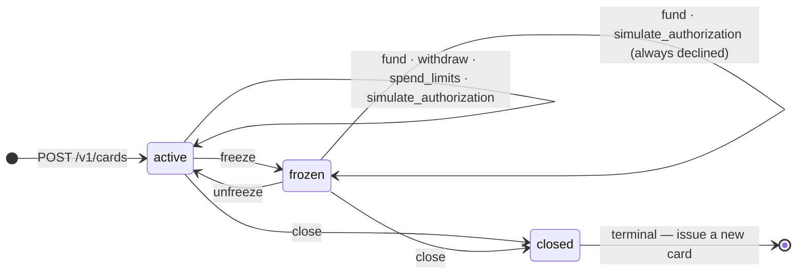
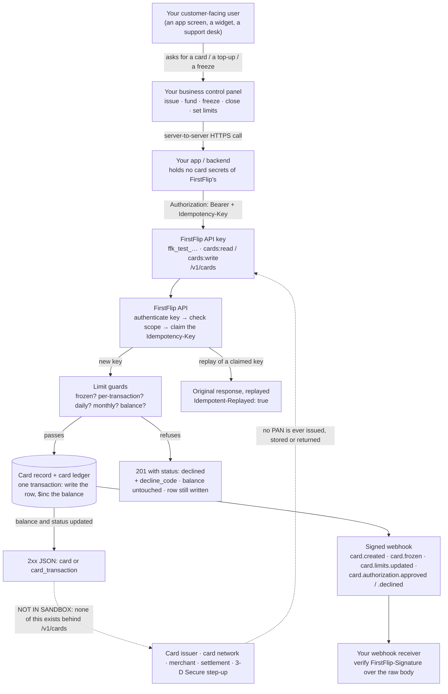
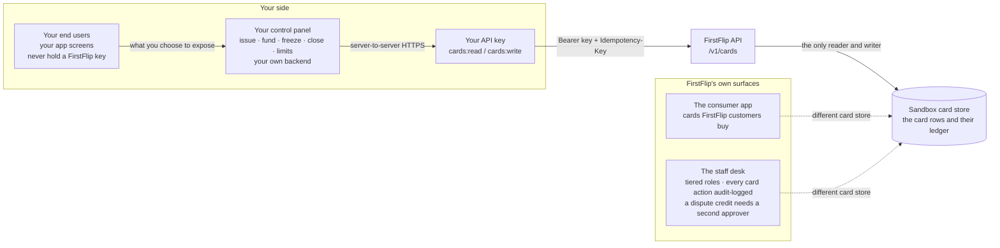

# Virtual cards

`POST /v1/cards` issues a **sandbox USD card** to one of your customers: create it, put a balance on
it, cap what it may spend, and run a simulated authorization through it to watch your limits fire.
A test-mode card is test mode all the way down, and the object says so out loud — `livemode: false`,
`sandbox.real_card: false`, `sandbox.funds_movable: false`. There is no issuer, no card network and
no real merchant behind this surface: no PAN is ever generated, stored or returned, nothing settles,
and **there is no step-up (no 3-D Secure) anywhere on it**.

A **live** key is not refused this surface with one blanket answer. Cards are answered **leg by leg**,
because the rails are not all missing at the same rate: listing, retrieval, freeze and unfreeze run
live today, and the six legs that would move money, release money or read rows this platform does not
hold answer `403 live_precondition_unmet` with the missing rail named in `error.param`. Only the
sandbox simulator still answers `403 live_mode_unavailable`. No live leg moves money yet — see
[Live legs](#live-legs).

## Quick hints

Short points that matter more than the paragraphs below them.

- **One `Idempotency-Key` per logical operation.** A fresh UUID per operation; reuse it only to retry
  *that* operation.
- **A replay returns the original response, so retry freely.** Same key + same body = the first
  answer again, with `Idempotent-Replayed: true`. Same key + different body = `422
  idempotency_key_reused`.
- **Never poll a card to find out whether a swipe was declined — read the response.** A declined
  authorization is a `201`; the refusal lives in the body (`status`, `decline_code`).
- **`201` versus `200` is not an accident.** The three writes that create a ledger row (`fund`,
  `withdraw`, `simulate_authorization`) answer `201`; the four that only change the card's own state
  (`freeze`, `unfreeze`, `close`, `spend_limits`) answer `200`. Treat both as success; never treat
  `201` as "created a card".
- **Every amount is dollars with at most 2 decimal places** — `balance`, `amount`, and each limit.
- **A limit of `null` means no cap on that axis**, not zero and not "blocked". The three axes are
  independent.
- **Two ceilings are ours, not yours.** A key may hold **250 cards open** (the 251st create answers
  `409 card_limit_reached`; closing one frees a slot), and your whole business may commit
  **$1,000,000 of approved spend per rolling 30 days** across every card you hold (declined as
  `over_tenant_monthly_limit`). Both are set far above what a sandbox integration uses; they exist so
  the surface can be opened up without a surprise later.
- **On `spend_limits`, omission is not the same as `null`.** Omit a key to leave that axis alone; send
  it as `null` to clear it.
- **A frozen card still takes money and still answers reads**: `fund` works, and an authorization is
  *declined in-body* with `card_frozen`. A `withdraw` from it is the one call the contract refuses
  outright (`409 card_not_active`).
- **`closed` is terminal.** Nothing reopens it — `unfreeze` tells you so ("Issue a new one.").
- **Store the card `id` when you create it.** The ledger is addressed by card
  (`GET /v1/cards/:id/transactions`); `GET /v1/cards` pages newest-first and does not filter by your
  `reference`.
- **`number_last4`, `expiry_month` and `expiry_year` are display furniture.** No card number exists,
  so never build a checkout form around them and never send them to a merchant.
- **Currency is `USD` and only `USD`.** Anything else is `400 invalid_parameter`.
- **A live key is answered per leg, not per surface.** `list`, `get`, `freeze` and `unfreeze` run
  live; the six money legs answer `403 live_precondition_unmet` and name the rail in `error.param`;
  only the simulator still answers `403 live_mode_unavailable`. The table is in
  [Live legs](#live-legs).
- **`limits` in the response is the resulting state**, so one `spend_limits` call tells you all three
  axes at once.
- **Every card route has a typed client method.** `firstflip.cards.*` covers all 11 (see
  [Node.js SDK](#nodejs-sdk)); REST and the agent tools are the same contract underneath.

## The lifecycle



What each state means for the call you are about to make:

| From | `fund` | `withdraw` | `simulate_authorization` | `freeze` / `unfreeze` | `spend_limits` | `close` |
|---|---|---|---|---|---|---|
| `active` | `201` | `201` (or `400 insufficient_balance`) | `201` — approved **or** declined | `200` | `200` | `200` |
| `frozen` | `201` | `409 card_not_active` | `201` with `decline_code: card_frozen` | `freeze` is what got you here; `unfreeze` → `active` (`200`) | the contract names no refusal | `200` |
| `closed` | `409 card_closed` ("Nothing moved.") | `409 card_closed` | `409 card_closed` | `unfreeze` → `409 card_closed` ("cannot be reopened. Issue a new one.") | the contract names no refusal | — |

Only `active → frozen → active` and `… → closed` are drawn above, because those are the moves the
contract defines. A read (`GET /v1/cards/:id`, `GET /v1/cards/:id/transactions`) works in every state.

## How a call travels, and where the sandbox stops

This is the whole path from your customer-facing screen to a FirstFlip event — and the leg that does
not exist, drawn as the dashed gap it is.



Read the dashed edges as the honest boundary: your side of the flow is real and complete, and every
outcome you can observe comes from the balance, the limits and the state on FirstFlip's side. Nothing
here can reach a merchant.

## Live legs

Cards are the one `/v1` surface that answers a live key **leg by leg** instead of with one blanket
refusal. The reason is that the rails are not all missing at the same rate: freeze and unfreeze are
the issuer's own verbs and reach it through the card's issuer record, while the money legs wait on
rails this platform has not built. A leg that is refused names its missing rail in `error.param`, so
your code branches on one code (`live_precondition_unmet`) and reads the decision that is missing —
it never parses prose, and it never has to guess whether a "no" was an incident.

| The eleven routes | What a **live** key gets today |
|---|---|
| `GET /v1/cards` | `200` — your live cards, and only those. Every row answers `livemode: true` with `sandbox: null`; a live page never contains a test card |
| `GET /v1/cards/{id}` | `200` as above. A card from the other mode is `404 resource_missing`, byte-for-byte the answer for a card that does not exist |
| `POST /v1/cards/{id}/freeze` | Runs live, **issuer first**: the provider is asked to freeze, and our record follows only if it agrees. A refusing issuer answers `503 service_unavailable` and the card stays `active` |
| `POST /v1/cards/{id}/unfreeze` | Runs live with the same ordering. A refusing issuer answers `503 service_unavailable` and the card stays `frozen` |
| `POST /v1/cards` | `403 live_precondition_unmet`, `param: cardholder` — a real card needs a cardholder the issuer has verified, and this API stores only the name and email you send it. No card is minted |
| `POST /v1/cards/{id}/fund` | `403 live_precondition_unmet`, `param: funding` — there is no tenant USD balance here to top a card up from. Refused before your amount is read |
| `POST /v1/cards/{id}/withdraw` | `403 live_precondition_unmet`, `param: withdrawal` — the leg that releases money back to you is not verified against the issuer |
| `POST /v1/cards/{id}/close` | `403 live_precondition_unmet`, `param: settlement` — a close returns the balance into a wallet, and that leg is not built. Nothing is terminated, on either side |
| `POST /v1/cards/{id}/spend_limits` | `403 live_precondition_unmet`, `param: limit_format` — the issuer has rejected every amount format tried on that call, and a ceiling in the wrong unit is worse than none, so it is not written our-side-only |
| `GET /v1/cards/{id}/transactions` | `403 live_precondition_unmet`, `param: transaction_sync` — the issuer's rows are not synced here yet, and an empty list would be a guess |
| `POST /v1/cards/{id}/simulate_authorization` | `403 live_mode_unavailable` — and this leg stays that way: a live authorization is decided by the issuer, so there is nothing for this API to simulate |

Two things worth reading twice:

- **`param: provider` is about your card, not a rail.** A live card row that carries no issuer id (or
  an issuer this server has no card code for) is refused rather than half-acted on. Live issuing is
  what puts that id on the row, so this arrives only for a row created before it opened.
- **A live refusal is a final response, so your `Idempotency-Key` replays it.** Resending the same key
  with the same body returns the same refusal. A new operation needs a new key.

None of this moves money. The money legs are refused *before* any balance is read, so a live card has
no path from this API to a debit — which is also why the ceilings below still apply only to test-mode
spend today.

## Who else can touch a card

Three ends, three permission models — and only one of them is yours.



| Surface | Can act on a card you issued through `/v1/cards`? | Why |
|---|---|---|
| Your end users, through your app | only as far as you let them | they never see a key; your backend makes the call |
| Your panel's backend | yes — this is the intended path | one `cards:write` key, one scope per call |
| A FirstFlip staff member | no | the staff desk reads a different card store |
| A FirstFlip customer in the app | no | same reason |

The last two rows are structural, not policy. Outside the tests, the sandbox card rows and their ledger
are read and written by exactly two things: the `/v1` card endpoints and the one ledger helper they share.
No mobile surface, staff surface, dispute desk or scheduled job in FirstFlip's server touches that store,
so a balance you created with a key cannot be moved by anyone who does not have that key.

Two consequences worth knowing before you build on it:

- **Your key is the panel.** There is no FirstFlip screen where an agent — yours or ours — unfreezes a
  sandbox card for you. If a card is stuck, the fix is a call with `cards:write`, and a support ticket ends
  with someone telling you which call to make.
- **Nothing reconciles it behind your back.** The hourly issuer-vs-FirstFlip reconciliation exists for cards
  that sit on a real rail. A sandbox card has no rail, so its balance has nothing to disagree with — and
  nothing that re-sums it on a schedule either. Your own `GET /v1/cards/:id/transactions` is the audit.

**Quick points**

- Ask *"can FirstFlip staff do this for me?"* before opening a ticket. For `/v1/cards` the answer is no by
  construction, and the API call is the only door.
- Treat `cards:write` as money code. It is the whole authority: whoever holds it *is* the panel.
- If you need a human in the loop, build it on your side — a queue, an approval, a step-up. FirstFlip's
  approval machinery guards its own rails, not your sandbox ledger.

## Issue a card

```bash
curl https://api.firstflip.ng/v1/cards \
  -H "Authorization: Bearer $FIRSTFLIP_SECRET_KEY" \
  -H "Idempotency-Key: $(uuidgen)" \
  -H "Content-Type: application/json" \
  -d '{
        "customer": { "first_name": "Ada", "last_name": "Obi", "email": "ada@example.com" },
        "reference": "employee_1042",
        "limits": { "per_transaction": 150, "daily": 500 },
        "metadata": { "programme": "team-cards" }
      }'
```

```json
{
  "id": "card_test_0a1b2c3d4e5f60718293a4b5",
  "object": "card",
  "livemode": false,
  "reference": "employee_1042",
  "status": "active",
  "currency": "USD",
  "balance": 0,
  "number_last4": "0817",
  "expiry_month": 8,
  "expiry_year": 2029,
  "limits": { "daily": 500, "per_transaction": 150, "monthly": null },
  "frozen_reason": null,
  "closed_reason": null,
  "created_at": "2026-11-09T10:30:00.000Z",
  "updated_at": "2026-11-09T10:30:00.000Z",
  "sandbox": { "real_card": false, "funds_movable": false }
}
```

`customer` (`first_name`, `last_name`, `email`) is required. `reference` and `metadata` are yours. A
`limits` axis you omit starts uncapped (`null`). This is `201` — the only card call where `201` means
"a card was created". Emits `card.created`.

```bash
curl https://api.firstflip.ng/v1/cards \
  -H "Authorization: Bearer $FIRSTFLIP_SECRET_KEY"
```

answers `{ "object": "list", "data": [ …cards… ], "has_more": false }`, newest first; page it with
`limit` (1–100, default 20) and `starting_after`.

## Move the balance

```bash
curl -X POST https://api.firstflip.ng/v1/cards/card_test_0a1b2c3d4e5f60718293a4b5/fund \
  -H "Authorization: Bearer $FIRSTFLIP_SECRET_KEY" \
  -H "Idempotency-Key: $(uuidgen)" \
  -H "Content-Type: application/json" \
  -d '{ "amount": 250, "reference": "topup_1042" }'
```

```json
{
  "id": "ctxn_test_1b2c3d4e5f60718293a4b5c6",
  "object": "card_transaction",
  "livemode": false,
  "card_id": "card_test_0a1b2c3d4e5f60718293a4b5",
  "reference": "topup_1042",
  "type": "topup",
  "status": "approved",
  "currency": "USD",
  "amount": 250,
  "balance_before": 0,
  "balance_after": 250,
  "merchant": null,
  "decline_code": null,
  "created_at": "2026-11-09T10:31:00.000Z",
  "sandbox": { "settled": false }
}
```

`withdraw` is the mirror image (`type: "withdrawal"`, `amount` off the balance). Both create a ledger
row, so both answer `201`.

| You ask for | On an `active` card | On a `frozen` card | On a `closed` card |
|---|---|---|---|
| `fund` of more than you have | `201` — the ceiling FirstFlip sets is on **spend**, so a top-up above it still lands | `201` | `409 card_closed` |
| `withdraw` of more than `balance` | `400 insufficient_balance` (`param: amount`) | `409 card_not_active` | `409 card_closed` |
| `withdraw` you can cover | `201` | `409 card_not_active` ("Unfreeze it first.") | `409 card_closed` |

`sandbox.funds_movable: false` on the card and `sandbox.settled: false` on the row are the contract
saying what this is: a balance FirstFlip increments for you, not money that can leave.

## Cap what it can spend

```bash
curl -X POST https://api.firstflip.ng/v1/cards/card_test_0a1b2c3d4e5f60718293a4b5/spend_limits \
  -H "Authorization: Bearer $FIRSTFLIP_SECRET_KEY" \
  -H "Idempotency-Key: $(uuidgen)" \
  -H "Content-Type: application/json" \
  -d '{ "daily_limit": 1000, "monthly_limit": null }'
```

`200` with the whole card, whose `limits` is the resulting state
(`{ "daily": 1000, "per_transaction": 150, "monthly": null }` above — `per_transaction` untouched).
Send one key or all three. `null` **clears** an axis; omission **leaves** it. Emits
`card.limits.updated`.

### What FirstFlip caps on top of your axes

Those three axes are yours and nothing clamps them — you can set `daily_limit` to any positive number.
What is not yours is the pair of platform ceilings, and they are the reason an integration can be
opened up before anyone has asked for limits of their own:

| Ceiling | What it counts | What happens when it is full |
|---|---|---|
| **250 open cards per key** | cards this credential issued that are not `closed` | the create is refused with `409 card_limit_reached` (`param: cards`), and nothing is written. Closing a card frees a slot; a retry of a create you already own is not counted again |
| **$1,000,000 of approved spend per business per rolling 30 days** | every approved authorization on every card the business holds in that mode — a second key of the same mode draws on the same bucket | the authorization is `201` with `decline_code: over_tenant_monthly_limit`, and no money moves |

The ceiling is on **spend**, so funding a card above it still lands — a sandbox you cannot top up is not
a sandbox. And because it is summed across your cards, splitting spend between two cards, or between two
keys of the same mode, does not multiply it. Test and live keep separate buckets, as every FirstFlip
namespace does; today only test-mode cards exist, so there is one bucket.

## Stop a card, then decide

```bash
curl -X POST https://api.firstflip.ng/v1/cards/card_test_0a1b2c3d4e5f60718293a4b5/freeze \
  -H "Authorization: Bearer $FIRSTFLIP_SECRET_KEY" \
  -H "Idempotency-Key: $(uuidgen)" \
  -H "Content-Type: application/json" \
  -d '{ "reason": "card_reported_lost" }'
```

`200` with `"status": "frozen"` and `"frozen_reason": "card_reported_lost"`. A frozen card declines
authorizations and refuses withdrawals, but it can still be funded, read and unfrozen.

```bash
curl -X POST https://api.firstflip.ng/v1/cards/card_test_0a1b2c3d4e5f60718293a4b5/unfreeze \
  -H "Authorization: Bearer $FIRSTFLIP_SECRET_KEY" \
  -H "Idempotency-Key: $(uuidgen)"
```

`200`, back to `active`, `frozen_reason` cleared — unless the card is `closed`, which is
`409 card_closed`: *"This card is closed and cannot be reopened. Issue a new one."*

`close` is the same shape with an optional `reason` and answers `200` with `"status": "closed"`.
Freeze and close are the calls you would use from a support desk or a risk rule; both emit an event
(`card.frozen`, `card.unfrozen`, `card.closed`).

## Simulate a swipe

```bash
curl -X POST https://api.firstflip.ng/v1/cards/card_test_0a1b2c3d4e5f60718293a4b5/simulate_authorization \
  -H "Authorization: Bearer $FIRSTFLIP_SECRET_KEY" \
  -H "Idempotency-Key: $(uuidgen)" \
  -H "Content-Type: application/json" \
  -d '{ "amount": 200, "merchant": "Office Depot" }'
```

```json
{
  "id": "ctxn_test_4e5f60718293a4b5c6d7e8f9",
  "object": "card_transaction",
  "livemode": false,
  "card_id": "card_test_0a1b2c3d4e5f60718293a4b5",
  "reference": null,
  "type": "authorization",
  "status": "declined",
  "currency": "USD",
  "amount": 200,
  "balance_before": 250,
  "balance_after": 250,
  "merchant": "Office Depot",
  "decline_code": "over_per_transaction_limit",
  "created_at": "2026-11-09T11:11:00.000Z",
  "sandbox": { "settled": false }
}
```

**That refusal is a `201`.** The card said no, the HTTP layer said the call worked, and the ledger kept
the row — `balance_before` equals `balance_after`, because a decline moves nothing. This is the single
most important shape difference on this resource: branch on `status`, never on the status code.

## Read the ledger

```bash
curl https://api.firstflip.ng/v1/cards/card_test_0a1b2c3d4e5f60718293a4b5/transactions \
  -H "Authorization: Bearer $FIRSTFLIP_SECRET_KEY"
```

`{ "object": "list", "data": [ …card_transaction… ], "has_more": false }`, newest first. Every
`topup`, `withdrawal` and `authorization` is a row here, **including the declined ones** — which makes
this the reconciliation view for a limit change you suspect bit a customer mid-checkout.

## Error and decline folds

Two different tables, because there are two different places a "no" arrives.

### HTTP errors this resource can answer

| Status | `code` | Retryable | What to do |
|---|---|---|---|
| 400 | `invalid_json` | no | Send valid JSON with `Content-Type: application/json` |
| 400 | `invalid_parameter` | no | Fix the field named in `param` — a currency other than `USD`, an amount that is not dollars with at most 2 decimals, a limit that is not a positive number, an empty `spend_limits` body |
| 400 | `insufficient_balance` | no | Cards only, on `withdraw`: `amount` is above `balance`. Nothing moved; re-read the card rather than guessing |
| 400 | `idempotency_key_required` | no | Add the `Idempotency-Key` header — every card POST needs one |
| 401 | `invalid_api_key` | no | The key is missing, malformed or revoked |
| 401 | `key_expired` | no | This key reached its expiry date. Create a new one — see [Authentication](authentication.md) |
| 403 | `insufficient_scope` | no | Mint a key carrying `cards:read` or `cards:write`; scopes are never widened in place |
| 403 | `live_mode_unavailable` | no | Only the simulator still answers this: a live authorization is decided by the issuer, so there is nothing to simulate. Use `ffk_test_…` for that leg |
| 403 | `live_precondition_unmet` | no | A live leg waiting on a rail we have not built; `param` names it — see [Live legs](#live-legs). Nothing moved |
| 403 | `ip_not_allowed` · `business_inactive` · `api_access_paused` | no | The key's allow-list, or a decision made above your key by FirstFlip — see [Authentication](authentication.md) |
| 404 | `resource_missing` | no | That card id does not exist **for this key**. Another business's id looks identical to a typo |
| 409 | `card_closed` | no | Terminal. Issue a new card; there is no unfreeze path out of `closed` |
| 409 | `card_not_active` | no | The card is frozen; `unfreeze` it before withdrawing |
| 409 | `card_limit_reached` | no | This key holds its **250 open cards** (`param: cards`). Close one — a closed card frees its slot — then issue again |
| 409 | `duplicate_reference` | no | Rare, and it means a race: a concurrent request with your `Idempotency-Key` won the create and the row is not readable yet. Fetch the card list rather than replaying the key |
| 409 | `idempotency_in_progress` | **yes** | Your first request with this key is still running. Wait, retry with the **same** key |
| 413 | `body_too_large` | no | Card bodies are small; something is wrong with what you sent |
| 422 | `idempotency_key_reused` | no | Same key, different body. New operation → new key |
| 429 | `rate_limited` | **yes** | Slow down; wait `Retry-After` seconds |
| 500 | `internal_error` | **yes** | Retry with the same key; quote `Request-Id` if it persists |
| 503 | `service_unavailable` | **yes** | Briefly unavailable; retry with the same key after `Retry-After` |

Full catalogue and header detail: [Idempotency and errors](idempotency-and-errors.md).

### In-body decline codes (arriving on a 201)

A `simulate_authorization` the card refuses is **not** an error: it is `201` with
`status: "declined"` and one of these in `decline_code`. **Read `status` and `decline_code` from the
body — never infer a decline from the HTTP status.** In decision order, first match wins:

| `decline_code` | Why the guard said no | What to do |
|---|---|---|
| `card_frozen` | The card is frozen | Nothing to fix on the amount; unfreeze it, or tell the customer it is blocked |
| `over_per_transaction_limit` | This one amount is above `limits.per_transaction` | Lower the amount or raise that axis with `spend_limits` |
| `over_daily_limit` | This amount would put today's spend above `limits.daily` | Wait for the day to roll, or raise `daily_limit` |
| `over_monthly_limit` | This amount would put the month's spend above `limits.monthly` | Wait for the month to roll, or raise `monthly_limit` |
| `over_tenant_monthly_limit` | This amount would put your **business's** rolling 30-day approved spend above $1,000,000, across every card you hold | Not yours to raise, and no single card caused it. Wait for the window to roll, or ask us |
| `insufficient_funds` | The balance does not cover the amount | `fund` the card |

A decline still writes a row, and `balance_before` equals `balance_after`. Your retry logic must
therefore key off the row, not off "did the call fail" — and a webhook (`card.authorization.declined`)
arrives for it just like an approval.

## Sandbox → live: the key structure

Cards inherit the platform's key model exactly. What is not the same as elsewhere is the *shape* of the
live answer: cards are opened leg by leg, so a live key is neither fully refused nor fully enabled.

| | `ffk_test_…` (today) | `ffk_live_…` (legs, not a switch) |
|---|---|---|
| Resolves to | your business, test data | your business, live data — a key can never read the other mode's objects |
| At rest | only a **SHA-256 hash** of the key is stored; the value is shown once and cannot be recovered by anyone, FirstFlip included | same |
| Scopes | chosen **at creation**, checked per endpoint (`cards:read` / `cards:write`), and **never widened in place** — rotate the key to change access | same |
| Expiry | a key may carry an `expires_at`; past it every route, cards included, answers `401 key_expired`. Rotation keeps an overlap window so a cut-over is not an outage — see [Authentication](authentication.md) | same rule |
| Rate bucket | its own per-key counters: 60 writes / 300 reads per minute, plus the per-IP backstop | same buckets |
| On `/v1/cards` | works end to end | **per leg.** `list`, `get`, `freeze` and `unfreeze` run. The six money legs answer `403 live_precondition_unmet` with the rail in `param`; only `simulate_authorization` still answers `403 live_mode_unavailable`. The guard is no longer one `requireTest` step on all 11 routes, so ordering matters: the scope check answers `403 insufficient_scope` first, and a `POST` with no `Idempotency-Key` answers `400 idempotency_key_required` first |

Four things have to exist before a live card key can issue and spend, and each is a decision rather
than a flag:

1. **A cardholder rail** the issuer accepts, so `POST /v1/cards` has a verified identity to register.
   This API records only the name and email you send it, which is not that.
2. **A funding and withdrawal rail**: a tenant USD balance this API may move money from, and a
   withdrawal leg verified against the issuer. Until then `sandbox.funds_movable` stays `false` in
   test mode, and the live legs are refused before your amount is read.
3. **Settlement on close**, so a terminated card returns its balance somewhere real.
4. **A limit format the issuer accepts**, and **transaction sync** so the issuer's rows are readable
   here instead of guessed at.

Real PAN custody and a step-up ceremony (3-D Secure) sit behind those, not beside them: no PAN exists
on this surface today, so there is nothing to protect, and **there is no step-up anywhere on it** —
budget both as new integration work when live issuing opens, not as something you can pre-wire.

So a developer can decide in one line:

- Building against cards today → use `ffk_test_…` with `cards:read` + `cards:write`. Everything in this
  guide works.
- Planning a live card launch → your `/v1/cards` calls keep their shape, and four of the eleven legs
  already answer live. Plan for real PAN custody rules and a step-up flow as **new** integration work,
  and branch on `error.param` rather than assuming a rail will appear. Do not build a production card
  programme on the sandbox balance, and do not tell your customers these cards can spend anywhere.
- Holding a live key today → you can already list, retrieve, freeze and unfreeze live cards, and nothing
  else. The refused legs answer `403 live_precondition_unmet` before touching a balance; the simulator
  answers `403 live_mode_unavailable`. A key with no card scope (and no scope list at all, which means
  every scope) is what decides whether you reach that leg or `403 insufficient_scope` first. One
  consequence worth knowing: a refusal is a final response, so it is cached against your
  `Idempotency-Key` and replayed — that key stays burned **inside live mode**. The same string is still
  free in test mode, because the idempotency scope is your account plus the mode.

## Retry safely

Every card POST requires an `Idempotency-Key`, and the layer behaves the way it does everywhere else on
`/v1`:

- Same key + same body → the original `201` (or `200`) answer again, `Idempotent-Replayed: true`.
  Fund a card twice with one key and the balance moves **once**.
- Same key + a different body → `422 idempotency_key_reused`, and nothing happens.
- Same key while the first request is still running → `409 idempotency_in_progress`, retryable.
- A `5xx` releases the key, so the same key can be retried and the operation runs again.

Use one key per **logical operation** (`fund-invoice-1042`, not one key per process) and generate it
before you send, not after. Keys live 24 hours. A declined authorization replayed under the same key
replays the same decline; under a fresh key it is a second row on the ledger. Details:
[Idempotency and errors](idempotency-and-errors.md).

## Scopes and rate limits

| Scope | Routes |
|---|---|
| `cards:read` | `GET /v1/cards`, `GET /v1/cards/:id`, `GET /v1/cards/:id/transactions` |
| `cards:write` | `POST /v1/cards` and the seven writes on `/v1/cards/:id/…` |

A key without the scope is `403 insufficient_scope`, which names the scope it wanted. **A key with an
empty scope list is not a key with no scopes** — it carries every scope its mode allows. That default
exists for keys minted before scopes did; check any old key before you ship it and re-mint it least-
privilege rather than assuming it is narrow. In practice: a reconciliation job needs `cards:read` only; a
support desk that freezes cards needs `cards:write` and no read of anything else. Rate limits are the `/v1` shape, per key per minute:
**60 writes**, **300 reads**, with a per-IP backstop of **1,200 requests** on one address. `429` carries
`Retry-After`; authenticated responses carry `X-RateLimit-Limit` and `X-RateLimit-Remaining`. Card
writes are cheap (one row, one `$inc`), so a burst of simulated authorizations is the usual way to trip
the write bucket — page your ledger with reads instead.

## Webhooks

Cards emit nine events to your registered **test** endpoints: `card.created`, `card.funded`,
`card.withdrawn`, `card.frozen`, `card.unfrozen`, `card.closed`, `card.limits.updated`,
`card.authorization.approved` and `card.authorization.declined`. The two money events carry the
`card_transaction`, so `amount` and `balance_after` arrive in the delivery. Verify
`FirstFlip-Signature` over the raw body and deduplicate on
`FirstFlip-Event-Id` exactly as for every other event — see [Webhooks](webhooks.md). A decline is
delivered as an event, so a well-wired webhook means you never poll `/transactions` to learn that a
limit fired.

## Node.js SDK

`@firstflip/node` (`sdks/node/`) has a typed method for every card route, so `firstflip.cards.*` is the
shortest path — it sends the `Idempotency-Key`, retries the retryable codes, and returns the same payloads
this page documents. The raw calls below are what that client puts on the wire, which is why they are worth
reading once (see [AI agents](agents.md) for the generated tools, same contract).

```js
const FirstFlip = require('@firstflip/node');
const firstflip = new FirstFlip(process.env.FIRSTFLIP_SECRET_KEY);

const card = await firstflip.cards.create({
  customer: { first_name: 'Ada', last_name: 'Obi', email: 'ada@example.com' },
  reference: 'employee_1042',
  per_transaction_limit: 150,
  daily_limit: 500,
});
await firstflip.cards.fund(card.id, { amount: 250 });
const swipe = await firstflip.cards.simulateAuthorization(card.id, { amount: 200, merchant: 'Office Depot' });
console.log(swipe.status, swipe.decline_code); // a decline is a 201 — branch on the body
```

The rest of this page is the same surface over raw HTTP, which is what the client is doing underneath:

```js
const BASE = 'https://api.firstflip.ng/v1';
const headers = (idempotencyKey, withJson = false) => ({
  Authorization: `Bearer ${process.env.FIRSTFLIP_SECRET_KEY}`, // ffk_test_…
  ...(idempotencyKey ? { 'Idempotency-Key': idempotencyKey } : {}),
  ...(withJson ? { 'Content-Type': 'application/json' } : {}),
});

// The three limit axes are flat fields on the create body — `limits` is what the response shows you, not
// what you send. FirstFlip's own two ceilings are not body fields at all: you cannot raise or lower them.
// Anything outside these fields is `400 invalid_parameter`.
const card = await fetch(`${BASE}/cards`, {
  method: 'POST',
  headers: headers('issue-card-for-1042', true),
  body: JSON.stringify({
    customer: { first_name: 'Ada', last_name: 'Obi', email: 'ada@example.com' },
    reference: 'employee_1042',
    per_transaction_limit: 150,
    daily_limit: 500,
  }),
}).then((r) => r.json());

// `fund` and `withdraw` take `amount` and nothing else; the ledger row is keyed by the card and this request.
await fetch(`${BASE}/cards/${card.id}/fund`, {
  method: 'POST',
  headers: headers('fund-card-1042-first-tranche', true),
  body: JSON.stringify({ amount: 250 }),
}).then((r) => r.json());

const auth = await fetch(`${BASE}/cards/${card.id}/simulate_authorization`, {
  method: 'POST',
  headers: headers('swipe-1042-0001', true),
  body: JSON.stringify({ amount: 200, merchant: 'Office Depot' }),
}).then((r) => r.json());

// A decline is a 201 — branch on the body.
console.log(auth.status, auth.decline_code); // declined over_per_transaction_limit
```

One `fetch` wrapper is enough: every card route takes the same headers, and the only per-route decision
is whether you send a body.
