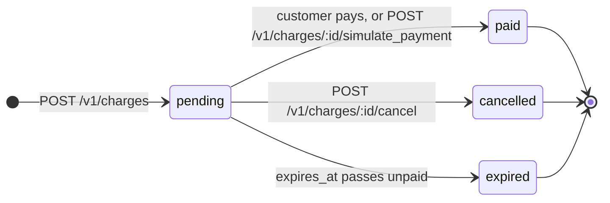
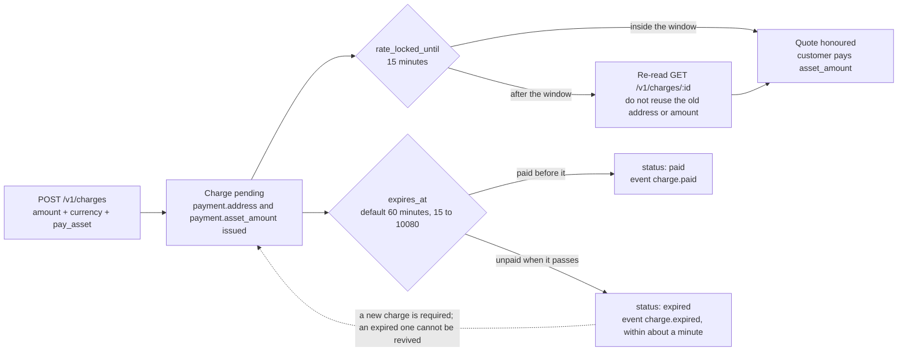

# Charges

A **charge** is one request for payment. You set the price in your currency; FirstFlip quotes it in the
crypto your customer pays with, and settles the value to your bank.

## Quick hints

Short points that matter more than the paragraphs below them.

1. **`amount` is in major units, not kobo or cents.** `32000` is ₦32,000 and `20.5` is $20.50 — up to 2 decimals. Sending minor units is how a ₦500 order becomes a ₦50,000 one.
2. **Show `asset_amount` exactly, and pay on `payment.network` only.** A short payment is not captured; a payment on the wrong network **can lose the funds**. This is the one mistake a retry cannot undo.
3. **The fee is on top, not out of your price.** `asset_amount` = your converted price + `fee_asset_amount`; you receive your full price.
4. **The quote is good for 15 minutes** (`rate_locked_until`). After that, re-read the charge — do not reuse the old address and amount.
5. **Fulfil from `charge.paid`, not from your own polling.** Only `pending` changes; `paid`, `cancelled` and `expired` are final and each one sends a [webhook](webhooks.md).
6. **`reference` is your order-level guard.** Unique per business, so a repeat is `409 duplicate_reference` — and `GET /v1/charges?reference=` returns the original instead of a second charge.
7. **Expiry defaults to 60 minutes** (15 to 10080). `charge.expired` lands within about a minute of `expires_at`, so an unpaid customer needs a new charge.
8. **The minimum is ₦5,000 / $5 today.** Below it, `amount_too_small` states the current figure — read it, do not hard-code it.
9. **Page with `starting_after` until `has_more` is `false`; reconcile with `created_from` / `created_before`.** Those two are inclusive/exclusive, so consecutive windows never count a charge twice.
10. **If you would rather not handle any of the above: redirect to `hosted_url`.** It is our page, with the amount, the address and live status.

## Lifecycle

These four values are the whole of `Charge.status`. Nothing else can appear in the field, and three of the
four are final.



Only `pending` changes. `paid`, `cancelled` and `expired` are final, and each sends a
[webhook](webhooks.md).

## Two clocks, not one

A charge carries two different deadlines and they are frequently confused. The quote clock is short and
renewable by re-reading; the payment clock is long and ends the charge.



## Creating a charge

| Field | Required | Notes |
|---|---|---|
| `amount` | yes | Your price in **major units**, up to 2 decimals: `32000` = ₦32,000, `20.5` = $20.50. Max ₦1bn / $1m per charge. |
| `currency` | yes | `NGN` or `USD` |
| `pay_asset` | no | `USDT` (default), `USDC`, `BTC` |
| `pay_network` | no | See the table below. Defaults to the asset's first network. |
| `reference` | no | Your order id. Unique per business, so a repeat returns `409 duplicate_reference`. |
| `description` | no | Shown to the customer on the hosted page. |
| `customer.name`, `customer.email` | no | For your records and the hosted page. |
| `expires_in_minutes` | no | 15 to 10080 (7 days). Default 60. |
| `metadata` | no | Up to 20 of your own key/value pairs, returned on the charge and in webhooks. |

| Asset | Networks |
|---|---|
| USDT | `trc20` (default), `bep20` |
| USDC | `bep20` |
| BTC | `bitcoin` |

**Minimum charge:** currently ₦5,000 or $5. If `amount` is below it, the `amount_too_small` error message
states the current minimum.

## The quote

```json
"payment": {
  "asset": "USDT",
  "network": "trc20",
  "address": "TEST-TRC20-9c2f4e1a7b3d5f6e8a0b",
  "asset_amount": 22.5,
  "fee_asset_amount": 2.5,
  "rate_locked_until": "2026-09-28T12:15:00.000Z"
}
```

- `asset_amount` is the **total** the customer sends: your price converted at the current rate, plus the
  FirstFlip service fee (`fee_asset_amount`). You receive your full price.
- The rate is locked for 15 minutes from creation (`rate_locked_until`).
- Show `asset_amount` exactly. Customers must send at least this amount on the stated network. Sending on
  the wrong network can lose the funds.

## Showing the payment to your customer

Either:

- **Redirect** to `hosted_url`. It is our page, with the amount, the address and live status. This is the
  least work and handles every edge case for you. Or:
- **Render it yourself** from `payment.address`, `payment.asset_amount` and `payment.network`, then poll
  `GET /v1/charges/:id` or wait for the webhook.

## Finding charges

`GET /v1/charges` returns newest first, 20 per page (up to 100 with `limit`). Filter by `status` or by
your `reference`. For the next page, pass the last id you received as `starting_after`, and stop when
`has_more` is `false`.

To reconcile a period, add `created_from` (inclusive) and `created_before` (exclusive) — RFC 3339,
a bare date meaning midnight UTC. `created_from=2026-11-04&created_before=2026-11-05` is exactly that
UTC day, and consecutive windows never count a charge twice. A malformed instant is
`400 invalid_parameter`.
