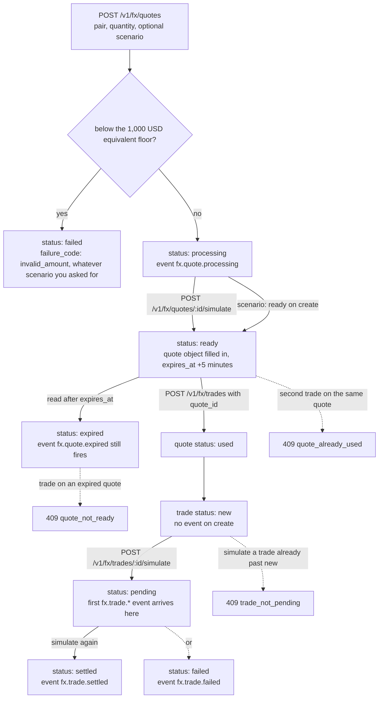

# FX quotes and trades (test mode)

`POST /v1/fx/quotes` asks for a rate; `POST /v1/fx/trades` books it. Rates in the sandbox are
fixed synthetic snapshots (`sandbox.synthetic_rate: true`), no money moves, and a live key gets
`403 live_mode_unavailable`. The point of the sandbox is to build and test your quote → trade flow,
including every failure your code must handle, before live FX opens.

## Quick hints

Short points that matter more than the paragraphs below them.

1. **Three pairs exist.** `NGN→USD`, `GHS→USD`, `USD→NGN`, at fixed synthetic rates. Any other pair is a `400` — and `scenario: invalid_currency_pair` still checks the real pair first, so a nonsense pair is never a 200.
2. **A ready quote lives 5 minutes.** Read `quote.expires_at`; do not assume the object you fetched at minute 1 is bookable at minute 6.
3. **Expiry can be lazy and still fires the event.** Reading an unpaid quote after its window answers `expired` *and* emits `fx.quote.expired`.
4. **There is a floor: the equivalent of 1,000 USD.** Below it the quote is created `failed` with `failure_code: invalid_amount`, whatever `scenario` you asked for.
5. **`quote` is `null` until `ready`** — and it stays readable once the quote is `used` or `expired`, so keep the object as your rate audit trail.
6. **One quote books one trade.** Creating the trade marks the quote `used`; a second trade on it is `409 quote_already_used`.
7. **`scenario` on create is how you avoid waiting.** Only ask for `processing` when you specifically want to exercise the async path.
8. **Creating a trade sends no event.** The first `fx.trade.*` arrives when the trade moves out of `new` — so build the fulfilment step on the event, not on the create response.
9. **Each object moves once.** `409 quote_not_ready` and `409 trade_not_pending` both mean "something already moved it" — fetch and read `status`.
10. **Both simulate calls are writes** and need an `Idempotency-Key` like every other POST here.

## Quote first, then trade — and only once

`FxQuote.status` has five values (`processing`, `ready`, `expired`, `failed`, `used`) and `FxTrade.status`
has four (`new`, `pending`, `settled`, `failed`). A quote is bookable in exactly one state, and booking it
consumes it.



Two things this draws that the prose buries: creating a trade emits **no** event, so fulfilment must hang off
`fx.trade.*` rather than the create response; and `quote` stays readable on a `used` or `expired` quote, which
is what makes the object worth storing as a rate audit trail.

## Pairs and amounts

| `base_currency` → `target_currency` | Sandbox rate |
|---|---|
| `NGN` → `USD` | 1 NGN = 0.000625 USD |
| `GHS` → `USD` | 1 GHS = 0.0625 USD |
| `USD` → `NGN` | 1 USD = 1,600 NGN |

`quantity` is in the base currency, up to two decimal places. The smallest quote is the equivalent
of **1,000 USD**, so below that the quote is created `failed` with `failure_code: "invalid_amount"`
whatever `scenario` you asked for.

## Quote

```bash
curl https://api.firstflip.ng/v1/fx/quotes \
  -H "Authorization: Bearer $FIRSTFLIP_SECRET_KEY" \
  -H "Idempotency-Key: $(uuidgen)" \
  -H "Content-Type: application/json" \
  -d '{
        "base_currency": "USD",
        "target_currency": "NGN",
        "quantity": 1000,
        "reference": "quote-1042"
      }'
```

```json
{
  "id": "fxq_test_9a8b7c6d5e4f3a2b1c0d9e8f",
  "object": "fx_quote",
  "livemode": false,
  "status": "ready",
  "reference": "quote-1042",
  "base_currency": "USD",
  "target_currency": "NGN",
  "quantity": 1000,
  "quote": {
    "rate": "1600",
    "approved_quantity": 1000,
    "total_value": 1600000,
    "expires_at": "2026-11-04T10:35:00.000Z"
  },
  "failure_code": null,
  "pricing": { "fee": 0, "currency": "USD", "status": "simulated" },
  "sandbox": { "synthetic_rate": true },
  "created_at": "2026-11-04T10:30:00.000Z"
}
```

`status` is `processing`, `ready`, `expired`, `failed` or `used`. `quote` is `null` until the quote
is `ready`; it stays readable once the quote is `used` or `expired`. A ready quote is good for
**5 minutes**.

### Choosing the outcome

`scenario` (optional, default `ready`) decides how the quote is created — no waiting needed:

| `scenario` | Result |
|---|---|
| `ready` | A usable quote, as above. |
| `processing` | `status: "processing"`, `quote: null`. Simulate it next. |
| `expired` | Created already `expired`. |
| `invalid_amount` | `failed`, `failure_code: "invalid_amount"`. |
| `invalid_currency_pair` | `failed`, `failure_code: "invalid_currency_pair"` (the pair itself is still checked first: an unsupported pair is a `400`). |
| `exceeded_limit` | `failed`, `failure_code: "exceeded_limit"`. |

### Simulate a processing quote

```bash
curl -X POST https://api.firstflip.ng/v1/fx/quotes/fxq_test_9a8b7c6d5e4f3a2b1c0d9e8f/simulate \
  -H "Authorization: Bearer $FIRSTFLIP_SECRET_KEY" \
  -H "Idempotency-Key: $(uuidgen)" \
  -H "Content-Type: application/json" \
  -d '{ "status": "ready" }'
```

`status` is `ready`, `failed` or `expired`. Only a `processing` quote that has not expired can move;
anything else is `409 quote_not_ready`.

Each state change emits `fx.quote.processing`, `fx.quote.ready`, `fx.quote.failed` or
`fx.quote.expired` — including the lazy expiry when an unpaid quote is read after its five minutes.

## Trade

A trade books a **ready** quote. Creating it marks the quote `used`, so one quote is good for one
trade.

```bash
curl https://api.firstflip.ng/v1/fx/trades \
  -H "Authorization: Bearer $FIRSTFLIP_SECRET_KEY" \
  -H "Idempotency-Key: $(uuidgen)" \
  -H "Content-Type: application/json" \
  -d '{ "quote_id": "fxq_test_9a8b7c6d5e4f3a2b1c0d9e8f", "narration": "November settlement" }'
```

```json
{
  "id": "fxt_test_1a2b3c4d5e6f708192a3b4c5",
  "object": "fx_trade",
  "livemode": false,
  "quote_id": "fxq_test_9a8b7c6d5e4f3a2b1c0d9e8f",
  "status": "new",
  "base_currency": "USD",
  "target_currency": "NGN",
  "quantity": 1000,
  "approved_quantity": 1000,
  "price": 1600000,
  "narration": "November settlement",
  "created_at": "2026-11-04T10:31:00.000Z"
}
```

- A quote that is not `ready` (or whose five minutes are gone) is `409 quote_not_ready`.
- A quote already booked by another trade is `409 quote_already_used`.
- `status` is `new`, `pending`, `settled` or `failed`.

### Simulate the trade

```bash
curl -X POST https://api.firstflip.ng/v1/fx/trades/fxt_test_1a2b3c4d5e6f708192a3b4c5/simulate \
  -H "Authorization: Bearer $FIRSTFLIP_SECRET_KEY" \
  -H "Idempotency-Key: $(uuidgen)" \
  -H "Content-Type: application/json" \
  -d '{ "status": "settled" }'
```

`status` is `pending`, `settled` or `failed`, and each move emits `fx.trade.pending`,
`fx.trade.settled` or `fx.trade.failed`. A trade moves out of `new`/`pending` once; asking for the
status it already has is `409 trade_not_pending`.

Creating a trade sends no event by itself: the first `fx.trade.*` event arrives when you simulate
the move out of `new`.

## Read back

`GET /v1/fx/quotes/:id` and `GET /v1/fx/trades/:id` return the same objects. Another business's id is
`404 resource_missing`, exactly as if it did not exist.

## Idempotency

Every write needs an `Idempotency-Key`, including both simulate calls. Reusing a key with a
different body is `422 idempotency_key_reused`; a retry with the same body returns the original
result. See [Idempotency & errors](idempotency-and-errors.md).

## Scopes and rate limits

Quotes and trades need `fx:write` to create or simulate and `fx:read` to read. Writes are limited to
60 per key per minute and reads to 300.

## Node.js SDK

```js
const quote = await firstflip.fx.createQuote({
  base_currency: 'USD', target_currency: 'NGN', quantity: 1000, scenario: 'processing',
});
await firstflip.fx.simulateQuote(quote.id, 'ready');
const trade = await firstflip.fx.createTrade({ quote_id: quote.id });
await firstflip.fx.simulateTrade(trade.id, 'settled');
```

`firstflip.fx.retrieveQuote(id)` and `.retrieveTrade(id)` mirror the reads.
