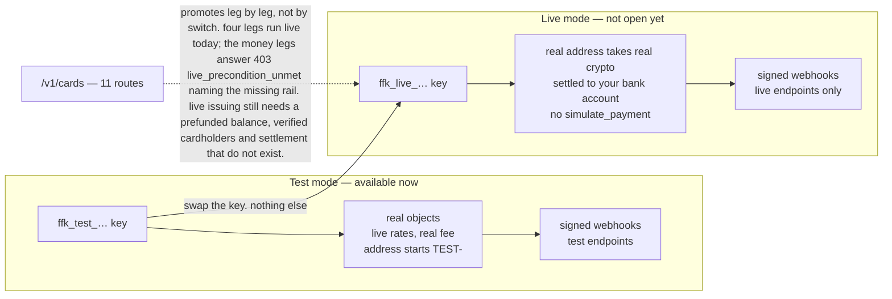

# Going live

**Live mode is not open yet.** This page says what will change when it opens, so you can build for it now.

## Quick hints

Ranked worst-first, each one checkable against this page or the spec:

1. **There is no live key to buy today.** A `ffk_live_…` cannot be minted yet, so write the swap as one config
   value — a branch in your code that chooses a key is a branch you have never run.
2. **Cards promote leg by leg, not all at once.** A live key can already `list`, `get`, `freeze` and `unfreeze`; the
   six money legs answer `403 live_precondition_unmet` naming the rail that is missing, and only the authorization
   simulator stays test-only. Keep card traffic on `ffk_test_…` until you have read
   [Live legs](cards.md#live-legs).
3. **Only the key changes.** Same endpoints, same request and response shapes, same events, same error codes,
   same per-key buckets (300 reads / 60 writes per minute). If your promotion plan lists anything else, it is
   describing a rewrite.
4. **Register the live webhook endpoint before you need it.** Live events go to live endpoints only — a key
   without an endpoint does not fail loudly, it silently produces events nobody receives.
5. **`TEST-` is watched by nothing; a live address is not.** Show `asset_amount` and network verbatim and warn
   that paying on the wrong network can lose funds.
6. **`simulate_payment` is a sandbox tool, not a live step.** Fulfil from `charge.paid` in both modes and the
   promotion touches no code.

## The one path, drawn

Read the dashed edge as the boundary: everything on the solid path promotes by configuration, and the card
resource promotes one leg at a time instead.

## What changes

Only the key. Swap `ffk_test_…` for `ffk_live_…` and add a live webhook endpoint (live events only go to
live endpoints). Endpoints, request and response shapes, events and error codes stay the same.

In live mode:

- `payment.address` is a real address that receives real crypto, and `hosted_url` is the live payment page.
- A paid charge is settled to the bank account on your FirstFlip business, in your currency.
- There is no `simulate_payment`.

## What goes live, and what does not

Cards no longer refuse a live key as one block. The seam answers per leg, so the question is which leg you are on:

| Your key carries | You send | You get |
|---|---|---|
| nothing card-shaped | any card route | `403 insufficient_scope` — scopes are checked before the leg runs |
| `cards:read` or `cards:write`, or an empty scope list | `list`, `get`, `freeze` or `unfreeze` | the live answer: your own cards, and on a freeze the issuer is asked before our row is written |
| the same scope | create, fund, withdraw, close, set spend limits, list transactions | `403 live_precondition_unmet`, and `error.param` names the rail — `cardholder`, `funding`, `withdrawal`, `settlement`, `limit_format` or `transaction_sync` |
| the same scope | `simulate_authorization` | `403 live_mode_unavailable` — a live authorization is decided by the issuer, so there is nothing to simulate |

A key minted with an empty scope list carries every scope its mode allows, so it lands in the second row
rather than the first — the mode is what decides the answer. A `POST` with no `Idempotency-Key` header is refused
`400 idempotency_key_required` before any of this is reached.

The refusals are deliberate and have no switch — not a flag nobody has flipped on yet: live issuing needs a
prefunded business balance, a verified cardholder the issuer can register, and per-card settlement, none of which
exists today. The shapes are already the live shapes, so when a rail lands the only change on your side is that its
leg stops refusing. Until then, keep the money legs on `ffk_test_…` and build the rest of your go-live plan around it.

## Who can go live

A verified FirstFlip business account with its payout bank account set. Live keys will be created by
the business owner in the app, when the Developer screen ships.

## Go-live checklist

- [ ] Every item in the [testing checklist](testing.md) passes.
- [ ] The live key is in your production secret store only, never in code.
- [ ] Your live webhook endpoint is registered and its secret deployed.
- [ ] You alert on webhook failures (the Developer screen will show failed deliveries when it ships;
      you can also reconcile daily with `GET /v1/charges?status=paid`).
- [ ] You show customers the exact `asset_amount` and network, and warn them that sending on the wrong
      network can lose funds.
