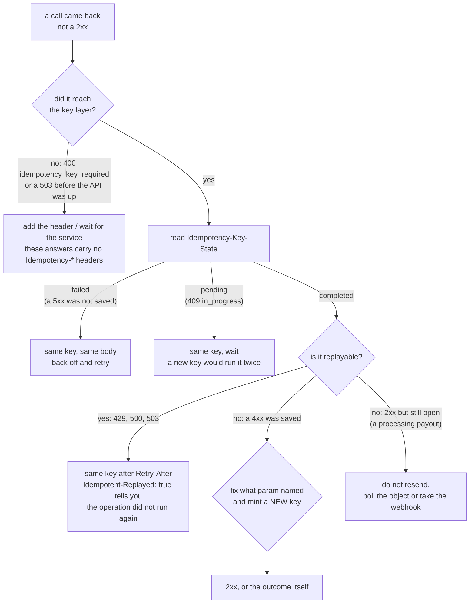

# Idempotency and errors

## Quick hints

Read in order — the first one that matches your call is the whole answer.

1. **Every POST needs `Idempotency-Key`.** A `400 idempotency_key_required` is a missing header, not a bad body, and it fires before your body is read.
2. **Branch on `code`, never on `message`.** `code` is stable and is what [the OpenAPI catalogue](../openapi.yaml) publishes under `x-error-codes`; `message` is prose and may change.
3. **A saved `4xx` replays.** After a refusal, the same key + the same body returns the *same* refusal. Fix the body **and** use a new key — a changed body under an old key is `422 idempotency_key_reused`.
4. **Only `5xx` releases the key.** A `failed` state means nothing was saved, so retry with the same key. `completed` means the answer is stored even when the money has not moved — follow the object, don't resend.
5. **Retry exactly these:** network errors, `409 idempotency_in_progress`, `429`, `500`, `503`. Every other 4xx fails identically no matter how many times you send it.
6. **`403` never answers "does this exist".** Rungs before the lookup refuse first, so a wrong id on a refused route still returns the `403`. A `404` is the first answer that actually looked at the resource. See [Authentication](authentication.md).
7. **`404` on another business's id is correct.** Ids do not cross businesses or modes; a missing-looking id is usually the other mode's key.
8. **Quote `Request-Id` when you ask us.** One UUID per request, on success and error alike; it is the exact line in our logs. A value you send is ignored.
9. **Nothing here is cacheable.** Every response says `Cache-Control: no-store` — balances and account data must not sit in a proxy.

## What to do when a call fails

The first question is never "which code" — it is "may I send this again, and with which key".



## Idempotency-Key (required on every POST)

Networks fail. A request can succeed on our side while the response is lost on the way back to you. An
`Idempotency-Key` makes a retry safe: we run the operation once and hand every retry the same result.

```http
Idempotency-Key: 7f1c0b9e-5d2a-4c6e-9a51-2b8f0e3d4c71
```

- Generate one key per **operation** (a UUID v4 works). Reuse it only to retry that same operation.
- Same key + same request → the original response, with the header `Idempotent-Replayed: true`.
- Same key + a **different** request → `422 idempotency_key_reused`. Nothing happens.
- Same key while the first request is still running → `409 idempotency_in_progress`. Wait and retry.
- Results are kept for 24 hours. A 5xx result is not kept, so retrying after a server error runs the
  operation again.
- Key order in the JSON body doesn't matter: `{"a":1,"b":2}` and `{"b":2,"a":1}` are the same request.
- Keys are private to your business and mode; another business using the same value is unaffected.

### What the key actually did — read it from the headers

A retry can arrive before the first request finished, or after it failed, so the headers on every keyed
answer tell you what happened. They are on every `2xx`, `409` and `422` that went through the key layer,
and they are declared in the OpenAPI files so a validator can assert them.

| Header | Sent | Values | Meaning |
|---|---|---|---|
| `Idempotency-Status-Version` | always | `1` | Read it first; a later version can add headers without breaking you |
| `Idempotent-Replayed` | always | `true` / `false` | `true`: this is the saved answer replayed — the operation did **not** run again |
| `Idempotency-Key-State` | always | `completed` / `pending` / `failed` | The key's state **after** this answer |
| `Idempotent-Original-At` | replay only | ISO 8601 | When the saved answer was stored |
| `Idempotency-Reference` | replay, when the answer has a receipt | string | The `reference` of the saved answer |

What each state means for your next move:

- **`completed`** — the answer is saved; a retry with this key gets this same response back with
  `Idempotent-Replayed: true`. A `4xx` that reached the key layer is saved the same way, so the key returns
  the same refusal. A `2xx` is `completed` even when its body says the outcome is still open (a payout that is
  `processing`, for example): the receipt exists, the money may still move — follow the object, don't resend.
- **`pending`** — another request with this key is still running (`409 idempotency_in_progress`). Wait and
  retry with the same key; a new key would start a second operation.
- **`failed`** — the answer was a `5xx`, so nothing was saved and the key was released. Retry with the same key;
  the operation runs again.

Answers that never reached the key layer carry none of these headers: `400 idempotency_key_required` (you sent
no key) and a `503` raised before the API is up (see below).

## Error shape

Every error has the same shape:

```json
{
  "error": {
    "type": "invalid_request_error",
    "code": "amount_too_small",
    "message": "The minimum charge is 5000 NGN",
    "param": "amount"
  }
}
```

Branch on `code`, which is stable. `message` is for humans and may change. `param` names the field at
fault when there is one.

Every response — success or error — also carries a `Request-Id` header: a UUID for that one request.
Quote it when you contact support about a failure; it identifies the exact request in our logs. A value
you send is ignored. It is declared `required` in the OpenAPI files, so a validator can assert it, and
every response is also marked `Cache-Control: no-store` (account data and balances must never sit in a
cache). Success responses declare the same headers as errors: the rate-limit pair on anything a limiter
saw — a `503` raised before the limiters (API or database down) is the one shape that may omit it — and
`Retry-After` on every `429` and every `503`. Read `code`, not `Retry-After`, to decide whether retrying
can help: `assistant_disabled` will not clear on its own.

| HTTP | `code` | What to do |
|---|---|---|
| 400 | `invalid_parameter` | Fix the field named in `param` |
| 400 | `amount_too_small` | Raise the amount (the message has the current minimum) |
| 400 | `idempotency_key_required` | Add the header (error type `idempotency_error`) |
| 400 | `question_required`, `question_too_long` | `POST /v1/assistant` only: the question must be 1–2,000 characters, and `param` is `question` |
| 400 | `invalid_json` | Send a valid JSON body with `Content-Type: application/json` |
| 400 | `invalid_otp`, `account_not_found` | The OTP is wrong (an attempt is used) · the destination is not a documented test account |
| 400 | `insufficient_balance` | Cards: the withdrawal asks for more than the card holds (the fault is on amount). Nothing moved; re-read the card for its balance |
| 401 | `invalid_api_key` | Check the key; it may be revoked |
| 401 | `key_expired` | This key reached its `expires_at`. Create a new one, or rotate before the date next time — see [Authentication](authentication.md) |
| 403 | `ip_not_allowed`, `business_inactive`, `live_mode_unavailable` | See [Authentication](authentication.md) |
| 403 | `insufficient_scope` | The key does not carry the scope this route needs; mint one that does |
| 403 | `api_access_paused` | FirstFlip paused API access for this business; contact support to resume it |
| 403 | `live_precondition_unmet` | Cards only, today: this live leg waits on a FirstFlip rail, and `param` names it (`cardholder`, `funding`, `withdrawal`, `settlement`, `limit_format`, `transaction_sync`, or `provider`). Nothing moved — run the leg on a test key |
| 404 | `resource_missing`, `not_found` | Wrong id or path. Another business's ids always look missing. |
| 409 | `idempotency_in_progress` | Retry shortly with the same key. The resource-specific 409s are folded below. |
| 413 | `body_too_large` | Keep request bodies under 64 KB |
| 422 | `idempotency_key_reused` | Use a new key for a new operation |
| 429 | `rate_limited` | Slow down; wait `Retry-After` seconds |
| 503 | `rate_unavailable`, `service_unavailable`, `verification_unavailable` | Rates, FirstFlip or the identity check are briefly unavailable; retry with the same key after `Retry-After` |
| 503 | `pricing_unavailable` | OTP pricing is briefly unavailable; retry later |
| 503 | `assistant_unavailable` | The assistant's model provider failed; retry, or read the page that answers your question |
| 503 | `assistant_disabled` | The developer assistant is switched off; do not retry until it is enabled |
| 500 | `internal_error` | Retry with the same key; contact us if it persists |

<details>
<summary><strong>409s by resource</strong> — the object moved on, your reference already exists, or a ceiling is
full. 8 codes, each with one repair.</summary>

| HTTP | `code` | What to do |
|---|---|---|
| 409 | `duplicate_reference` | You already have a charge with this `reference`; fetch it with `?reference=` |
| 409 | `charge_not_pending` | The charge already finished; fetch it for its final status |
| 409 | `card_closed` | That card is closed, and `closed` is terminal — issue a new one. Nothing moved |
| 409 | `card_not_active` | Cards: the card is frozen and only an active card can be withdrawn from; unfreeze it first |
| 409 | `card_limit_reached` | Cards: this key already holds its **250 open cards** (`param: cards`). Close one — a closed card frees its slot — then issue again |
| 409 | `quote_not_ready`, `quote_already_used`, `trade_not_pending` | FX state moved on; request a fresh ready quote or fetch the trade |
| 409 | `account_inactive`, `transfer_not_pending`, `verification_not_pending`, `otp_not_pending`, `subaccount_not_active`, `subaccount_not_suspended` | That object already left the state you are acting on (a concurrent call got there first); fetch it and read its `status` — suspend and activate are idempotent, so a retry answers `200` |
| 409 | `bvn_not_verified` | The BVN check is missing, unverified, expired, or does not match the customer's name |

Every row here is the same shape: **the refusal is about state, not about your request.** Resending it unchanged
cannot help; fetching the object and reading its `status` always can. None of them moved money.

</details>

## Rate limits

Per key: **300 reads** and **60 writes** per minute. Over the limit you get `429` with
`Retry-After` and `X-RateLimit-*` headers. Back off and retry.

## Retry policy we recommend

Retry on network errors, `409 idempotency_in_progress`, `429`, `500` and `503`, always with the
**same** Idempotency-Key, using exponential backoff (1 s, 2 s, 4 s … up to about a minute). Do not retry
other 4xx errors unchanged; they will fail the same way.
