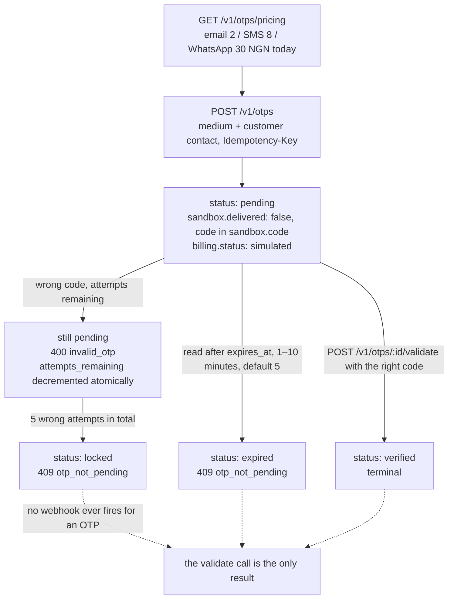

# One-time passwords (test mode)

`/v1/otps` sends and checks a one-time code for you, so your app never owns an SMS, email or WhatsApp pipeline.
Price it, create the code, hand it to the customer, validate what they type. Everything is test mode: nothing is
delivered, the sandbox code is returned to you, and the charge is simulated. A live key gets
`403 live_mode_unavailable`.

## Quick hints

Short points that matter more than the paragraphs below them.

1. **Nothing is delivered.** `sandbox.delivered` is `false` and the code arrives in `sandbox.code` so you can finish the flow. That field does not exist in live mode — treat it as test-only plumbing and never render it in a UI you ship.
2. **`400 invalid_otp` and `409 otp_not_pending` are different sentences.** The first says the code they typed is wrong; the second says the code is dead — locked, verified or expired. Branch on them separately, because the repair is different.
3. **Five wrong attempts lock the code**, and the counter is atomic: two concurrent validates can neither exceed five attempts nor verify the same code twice. Read `attempts_remaining` rather than counting in your own database.
4. **Read the price, do not hard-code it.** `GET /v1/otps/pricing` is operator-configurable (email 2 / SMS 8 / WhatsApp 30 NGN today).
5. **No wallet is debited.** `billing.status` is `simulated`, and `billing.amount` is the retail total for the mediums you chose — so multi-medium sends bill once per medium.
6. **There are no webhook events for OTPs.** The validate call is the result you act on; nothing will tell you later.
7. **Expiry is 1–10 minutes (default 5) and lazy** — a read after `expires_at` shows `expired`. If your UI holds a countdown, drive it from `expires_at`, not from your own arithmetic.
8. **Contact details are validated and then discarded**; the sandbox persists no phone number or email. Do not assume you can read them back, and do not keep them either.
9. **Field requirements follow `medium`.** `email` needs `customer.email`; `sms` and `whatsapp` need `customer.phone` with the country code. `send` accepts only `true`, if you send it at all.

## The code has four states and two of them are dead ends

`Otp.status` is `pending`, `verified`, `expired` or `locked`. Only the first two arrows below are a customer
success; the other two both refuse the code, and they refuse it with different error codes.



Branch on the two refusals separately: `400 invalid_otp` means the code they typed is wrong and they can try
again, while `409 otp_not_pending` means the code is dead and only a new `POST /v1/otps` helps. Because there
are no OTP events, nothing arrives later to tell you which one the customer hit.

## What it costs

```bash
curl https://api.firstflip.ng/v1/otps/pricing \
  -H "Authorization: Bearer $FIRSTFLIP_SECRET_KEY"
```

```json
{
  "object": "otp_pricing",
  "currency": "NGN",
  "data": [
    { "medium": "email", "unit_amount": 2 },
    { "medium": "sms", "unit_amount": 8 },
    { "medium": "whatsapp", "unit_amount": 30 }
  ]
}
```

`unit_amount` is what you pay per code, in NGN. Read this endpoint rather than hard-coding a price — the figures are
operator-configurable.

## Create a code

```bash
curl https://api.firstflip.ng/v1/otps \
  -H "Authorization: Bearer $FIRSTFLIP_SECRET_KEY" \
  -H "Idempotency-Key: $(uuidgen)" \
  -H "Content-Type: application/json" \
  -d '{
        "customer": { "name": "Ada Obi", "phone": "+2348030000001" },
        "medium": ["sms"],
        "length": 6,
        "expiry": 5
      }'
```

```json
{
  "id": "otp_test_4d5e6f708192a3b4c5d6e7f8",
  "object": "otp",
  "livemode": false,
  "status": "pending",
  "medium": ["sms"],
  "length": 6,
  "attempts_remaining": 5,
  "billing": { "currency": "NGN", "amount": 8, "status": "simulated" },
  "expires_at": "2026-11-04T10:35:00.000Z",
  "verified_at": null,
  "created_at": "2026-11-04T10:30:00.000Z",
  "sandbox": { "code": "123456", "delivered": false }
}
```

| Field | Rule |
|---|---|
| `customer.name` | Required, up to 100 characters |
| `customer.email` | Required when `medium` includes `email`, and must be valid |
| `customer.phone` | Required for `sms` and `whatsapp`; include the country code (`+234…`) |
| `medium` | 1–3 unique values from `email`, `sms`, `whatsapp`; default `["sms"]` |
| `length` | 5, 6 or 7 digits; default 6 |
| `expiry` | 1–10 minutes; default 5 |
| `sender` | Optional sender id, up to 35 characters |
| `send` | Only `true` is accepted, if you pass it at all |

- **Nothing is delivered**: `sandbox.delivered` is `false` and the code is returned in `sandbox.code` so you can
  finish the flow. In live mode the code is never returned.
- `billing.amount` is the retail total for the chosen mediums (`8` for one SMS by default), and `billing.status` is
  `simulated`: no wallet is debited.
- Customer contact details are validated and then discarded — the sandbox does not persist a phone number or email.

## Validate what the customer typed

```bash
curl -X POST https://api.firstflip.ng/v1/otps/otp_test_4d5e6f708192a3b4c5d6e7f8/validate \
  -H "Authorization: Bearer $FIRSTFLIP_SECRET_KEY" \
  -H "Idempotency-Key: $(uuidgen)" \
  -H "Content-Type: application/json" \
  -d '{ "otp": "123456" }'
```

A correct code returns the code with `status: "verified"` and `verified_at` set.

| What happened | Response |
|---|---|
| Correct code | `200`, `status: verified` |
| Wrong code | `400 invalid_otp` (param `otp`), one attempt consumed |
| Fifth wrong attempt | `400 invalid_otp`, and the code is now `locked` |
| Validating a locked, verified or expired code | `409 otp_not_pending` |

- `attempts_remaining` counts down from 5 on the object; check it with `GET /v1/otps/:id`.
- Attempts and the outcome resolve in one atomic move, so two concurrent validates cannot exceed five attempts or
  verify the same code twice.
- Expiry is lazy: reading a code after `expires_at` shows `expired`, and validating it is `409 otp_not_pending`.
- There are no webhook events for `otps`; validation is the result you act on.

## Retry safely

Every write needs an `Idempotency-Key`. Retrying a create with the same key returns the same code instead of sending
and billing a second one; reusing a key with a different body is `422 idempotency_key_reused`. See
[Idempotency & errors](idempotency-and-errors.md).

## Scopes and rate limits

Creating and validating need `otps:write`; pricing and reads need `otps:read`. Writes are limited to 60 per key per
minute and reads to 300.

## Node.js SDK

```js
const price = await firstflip.otps.pricing();
const sms = price.data.find((p) => p.medium === 'sms');
console.log(sms.unit_amount); // NGN per code

const otp = await firstflip.otps.create({
  customer: { name: 'Ada Obi', phone: '+2348030000001' },
  medium: ['sms'],
});
console.log(otp.billing.amount, otp.sandbox.code); // 8 123456 (sandbox only)

const done = await firstflip.otps.validate(otp.id, otp.sandbox.code);
console.log(done.status, done.verified_at); // verified <timestamp>
```

`firstflip.otps.retrieve(id)` reads the code back, `attempts_remaining` included.
