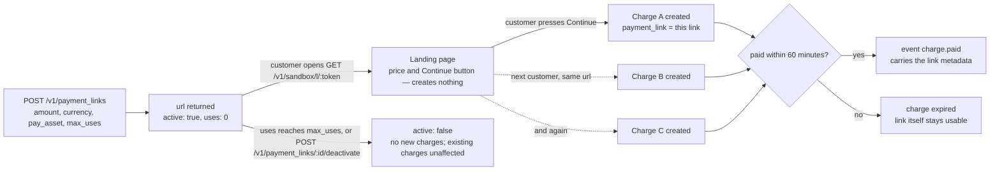

# Payment links

A **payment link** is one URL you can share anywhere: a WhatsApp status, an Instagram bio, an email, a
printed QR on your counter. Every customer who opens it and presses **Continue** gets their own charge,
so payments never mix and each one fires its own webhook.

No website or checkout code needed. Create the link once, share it, and handle `charge.paid` (or check
the charges list) as usual.

## Quick hints

Short points that matter more than the paragraphs below them.

1. **One link is many charges.** Each customer who presses **Continue** gets their own charge and their own `charge.paid` — payments never mix, and one customer's short payment cannot block another.
2. **Opening the link creates nothing.** A chat app fetching a preview burns no use and makes no charge; only **Continue** does.
3. **`max_uses` counts presses, not payments.** A link capped at 100 can be exhausted by 100 people who never pay. Watch `uses` with `GET /v1/payment_links?active=true`.
4. **`reference` and `customer` are not allowed** — they are per-customer fields on a per-customer-free object. Put your own tags in `metadata`; they land on every charge the link makes.
5. **Share `url`, not `id`.** The `id` is for `deactivate` and for filtering charges.
6. **An unpaid charge from a link expires in 60 minutes and the customer can simply open the link again.** No repair call, no new link.
7. **`POST /v1/payment_links/:id/deactivate` stops the link at once** and leaves charges already created untouched — they still pay and still fire webhooks.
8. **Attribute by `payment_link`.** It is a field on the charge and in `charge.paid`, so one filter answers "what did this link collect".
9. **The money rules are the [charge](charges.md) rules** — major units, minimum, asset, network, fee on top. A link changes only who creates the charge.

## Create

```bash
curl https://api.firstflip.ng/v1/payment_links \
  -H "Authorization: Bearer $FIRSTFLIP_SECRET_KEY" \
  -H "Idempotency-Key: $(uuidgen)" \
  -H "Content-Type: application/json" \
  -d '{ "amount": 8000, "currency": "NGN", "description": "Jollof tray", "max_uses": 100, "metadata": { "menu": "lunch" } }'
```

```json
{
  "id": "pl_test_7d2c1b0a9e8f6d5c4b3a2918",
  "object": "payment_link",
  "active": true,
  "url": "https://api.firstflip.ng/v1/sandbox/l/5f2d8c1e9a7b4d3c6e0f1a2b3c4d5e6f",
  "amount": 8000,
  "currency": "NGN",
  "max_uses": 100,
  "uses": 0
}
```

Share `url`.

## What the customer sees

1. Opening the link shows the price and a **Continue to payment** button. Opening it alone creates
   nothing, so chat apps fetching a link preview don't create charges.
2. **Continue** creates a charge for that customer and takes them to its payment page.
3. When they pay, you get `charge.paid`. The charge's `payment_link` field says which link it came from,
   and it carries the link's `metadata`.

## One link, many charges

A link is a template, not an order. Each customer who presses **Continue** gets their own charge, and the
link only counts uses — that is why `reference` and `customer` are refused on a link.



Opening the url is deliberately not the create step: a chat app that fetches the link to build a preview
does not consume a `max_uses` slot.

## Limits and control

- `max_uses` stops the link after that many charges (counted when a customer presses Continue, whether or
  not they pay). Omit it for an unlimited link.
- `POST /v1/payment_links/:id/deactivate` stops a link at once. Charges already created are unaffected.
- `GET /v1/payment_links?active=true` lists your live links, with `uses` so far. Add
  `created_from` (inclusive) / `created_before` (exclusive) to read a period — RFC 3339, bare date
  meaning midnight UTC, so consecutive windows never count a link twice.
- Each charge from a link expires after 60 minutes if unpaid; the customer can open the link again.

Amount, currency, asset, network, description and metadata follow the same rules as
[charges](charges.md). `reference` and `customer` are not allowed on a link, because many customers pay it.

## Find payments from a link

```bash
curl "https://api.firstflip.ng/v1/charges?status=paid&limit=100" -H "Authorization: Bearer $FIRSTFLIP_SECRET_KEY"
```

Filter the results on `payment_link`, or match `charge.paid` events by `data.object.payment_link`.
