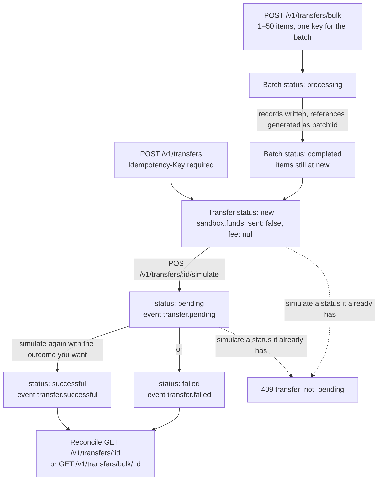

# Payouts (test mode)

`POST /v1/transfers` records one **test** transfer to a beneficiary abroad or a mobile wallet.
`POST /v1/transfers/bulk` records 1–50 of them in a single call — the bulk-payout shape. Nothing is
sent and no fee is quoted: the response always carries `sandbox.funds_sent: false` and `fee: null`.
Live payout rails are not open yet, and a live key gets `403 live_mode_unavailable`.

## Quick hints

Short points that matter more than the paragraphs below them.

1. **Nothing moves here.** Every response says `sandbox.funds_sent: false` and `fee: null`, and a live key is refused before your body is read. Build the shape, rehearse the callback, expect `403` on the way to live.
2. **A batch's `status: completed` means the records were created.** Every payout inside it still starts at `new` and must be simulated one by one.
3. **Never send `reference` per item.** FirstFlip generates `<batch id>:<index>`; a per-item reference is `400 invalid_parameter`.
4. **The corridor decides the required fields, not the type alone.** `USD`/`EUR`/`GBP` each need their own `beneficiary` block, `UG` `bank_account` adds `destination_branch_code`, `ZA` adds `email`, `recipient_address` and a `+27` mobile number.
5. **Precision is per currency.** `XOF`, `XAF`, `UGX` and `RWF` are whole numbers only; fiat takes 2 decimals; stablecoins take up to 6 (`25.0000001` is refused).
6. **A transfer leaves `new`/`pending` once.** Asking for a status it already has is `409 transfer_not_pending` — so drive your state machine from `transfer.pending` / `.successful` / `.failed` [events](webhooks.md), not from a second simulate call.
7. **One `Idempotency-Key` for the whole batch.** After a timeout, retry with the same key and you get the same batch back; a fresh key with the same body creates a second run.
8. **A stablecoin transfer is never cross-converted.** `debit_currency` may name a fiat wallet (`NGN`, `USD`, `GBP`, `EUR`, `GHS`) or the same stablecoin, nothing else.
9. **You never see the full destination.** Only `beneficiary.account_last4` is echoed — keep your own copy if you need it.
10. **Reconcile with a half-open window.** `created_from` is inclusive, `created_before` exclusive, and `starting_after` paging holds even though a bulk batch writes all its rows in one instant.

## How a payout moves

`Transfer.status` has exactly four values — `new`, `pending`, `successful`, `failed` — and a batch has two of
its own, `processing` and `completed`. They are on different clocks, which is the single most misread thing
about bulk payouts.



A batch reaching `completed` means the records exist, not that the money path finished: every item inside
still has to be simulated one at a time. Read `batch: completed` as "N transfers now sit at `new`".

## One transfer

```bash
curl https://api.firstflip.ng/v1/transfers \
  -H "Authorization: Bearer $FIRSTFLIP_SECRET_KEY" \
  -H "Idempotency-Key: $(uuidgen)" \
  -H "Content-Type: application/json" \
  -d '{
        "type": "mobile_money",
        "country": "GH",
        "currency": "GHS",
        "account_bank": "MTN",
        "account_number": "233240000001",
        "amount": 100,
        "beneficiary_name": "Test Customer"
      }'
```

```json
{
  "id": "tr_test_8f1e2d3c4b5a69788796a5b4",
  "object": "transfer",
  "livemode": false,
  "reference": "tr_test_8f1e2d3c4b5a69788796a5b4",
  "status": "new",
  "type": "mobile_money",
  "country": "GH",
  "network": null,
  "currency": "GHS",
  "debit_currency": "GHS",
  "amount": 100,
  "beneficiary": { "account_last4": "0001" },
  "fee": null,
  "fee_currency": "GHS",
  "sandbox": { "funds_sent": false, "fee_quoted": false },
  "created_at": "2026-11-04T07:30:00.000Z"
}
```

Only the last four digits of the destination are echoed (`beneficiary.account_last4`). `status` is one of
`new`, `pending`, `successful`, `failed`.

### Corridors and required fields

`amount` and `currency` are required; everything else depends on `type` (default `international_bank`).
`beneficiary_name` is required for every type except the stablecoin types.

| `type` | Where | What you send |
|---|---|---|
| `international_bank` | `USD`, `EUR`, `GBP` | `account_number` (5–34 letters/digits), `beneficiary_name`, and `beneficiary` with the currency's fields (below). |
| `mobile_money` | `CI`/`XOF`, `GH`/`GHS`, `KE`/`KES`, `RW`/`RWF`, `SN`/`XOF`, `UG`/`UGX`, `EG`/`EGP` | `account_bank` (one of the country's networks), `account_number` with the country code (no leading `+`). |
| `bank_account` | `CM`/`XAF`, `CI`/`XOF`, `ZA`/`ZAR`, `UG`/`UGX` | `account_bank`, `account_number` in the local format; `UG` also needs `destination_branch_code`. |
| `stablecoin` | `USDT`, `USDC`, `RLUSD` on `SOLANA`, `ETHEREUM`, `BASE`, `POLYGON` | `network`, `account_number` = the wallet address. |
| `stablecoin_funding` | `USDT`, `USDC` or `RLUSD`, debited in `NGN`, `USD`, `GBP`, `EUR` or `GHS` | No recipient fields — it targets your own business wallet. |

Required `beneficiary` fields for `international_bank`:

- **USD** — `routing_number`, `swift_code`, `bank_name`, `account_type` (`checking` or `depository`),
  `beneficiary_address`, `postal_code`, `street_number`, `street_name`.
- **GBP** — `routing_number`, `bank_name`, `account_type` (`personal` or `corporate`). A corporate
  account also needs `beneficiary_merchant_name`; a personal one needs `first_name` and `last_name`
  that match `beneficiary_name`.
- **EUR** — `routing_number`, `swift_code`, `bank_name`, `postal_code`, `street_number`, `street_name`,
  `city`.

A `bank_account` for `ZA` additionally needs `beneficiary.email`, `beneficiary.recipient_address` and
`beneficiary.mobile_number` (`+27…`), with `first_name`/`last_name` matching `beneficiary_name`.

`debit_currency` defaults to `currency`. A stablecoin transfer is never cross-converted: keeping it may
only name a fiat wallet (`NGN`, `USD`, `GBP`, `EUR`, `GHS`) or the same stablecoin.

### Amounts

Fiat amounts take up to two decimal places. `XOF`, `XAF`, `UGX` and `RWF` are whole numbers only.
Stablecoins take up to six decimal places (`25` or `0.500000`, not `25.0000001`). Amounts must be
positive.

## Simulate the result

```bash
curl -X POST https://api.firstflip.ng/v1/transfers/tr_test_8f1e2d3c4b5a69788796a5b4/simulate \
  -H "Authorization: Bearer $FIRSTFLIP_SECRET_KEY" \
  -H "Idempotency-Key: $(uuidgen)" \
  -H "Content-Type: application/json" \
  -d '{ "status": "successful" }'
```

`status` is `pending`, `successful` or `failed`. A transfer moves out of `new`/`pending` once — asking
for a status it already has is `409 transfer_not_pending`. Each move emits `transfer.pending`,
`transfer.successful` or `transfer.failed` to your webhook endpoints, so you can rehearse the callback
path before live mode.

## Bulk payouts

```bash
curl https://api.firstflip.ng/v1/transfers/bulk \
  -H "Authorization: Bearer $FIRSTFLIP_SECRET_KEY" \
  -H "Idempotency-Key: $(uuidgen)" \
  -H "Content-Type: application/json" \
  -d '{
        "transfers": [
          { "type": "mobile_money", "country": "UG", "currency": "UGX", "account_bank": "MTN",
            "account_number": "256240000001", "amount": 1000, "beneficiary_name": "Test Customer" },
          { "type": "stablecoin", "currency": "USDT", "network": "SOLANA",
            "account_number": "7xKXtg2CW87d97TXJSDpbD5jBkheTqA83TZRuJosgAsU", "amount": 25 }
        ]
      }'
```

```json
{
  "id": "trb_test_41c2d3e4f5a6b7c8d9e0f1a2",
  "object": "transfer_batch",
  "livemode": false,
  "status": "completed",
  "count": 2,
  "data": [
    { "id": "tr_test_1a2b3c4d5e6f708192a3b4c5", "status": "new", "reference": "trb_test_41c2d3e4f5a6b7c8d9e0f1a2:0", "object": "transfer" },
    { "id": "tr_test_2b3c4d5e6f708192a3b4c5d6", "status": "new", "reference": "trb_test_41c2d3e4f5a6b7c8d9e0f1a2:1", "object": "transfer" }
  ]
}
```

- 1 to 50 items, each validated exactly like a single transfer.
- **Do not send `reference` per item** — FirstFlip generates one (`<batch id>:<index>`). A per-item
  reference is `400 invalid_parameter`.
- `status: completed` means the **records were created**, not that money moved: every transfer still
  starts at `new`. Simulate each one as in the single-transfer flow.
- Every entry in `data` is the full transfer object shown above (`beneficiary`, `fee` and `sandbox`
  included; they are trimmed here for length).
- Read the batch back with `GET /v1/transfers/bulk/:id`; read one payout with `GET /v1/transfers/:id`.

## List payouts

`GET /v1/transfers` returns your transfers newest first — the reconciliation view.

```bash
curl "https://api.firstflip.ng/v1/transfers?status=failed&limit=20" \
  -H "Authorization: Bearer $FIRSTFLIP_SECRET_KEY"
```

```json
{
  "object": "list",
  "data": [ { "id": "tr_test_8f1e2d3c4b5a69788796a5b4", "status": "failed", "object": "transfer" } ],
  "has_more": false
}
```

- `limit` is 1–100 (default 20). For the next page pass the last `id` as `starting_after` and stop
  when `has_more` is `false`.
- `status` filters to `new`, `pending`, `successful` or `failed`; `batch_id` narrows to the payouts
  one bulk call created.
- Paging is stable even though a bulk batch writes all its rows at the same instant: you get every
  payout exactly once, never a skipped or duplicated one.
- `starting_after` must be one of your transfers, or the API answers `400 invalid_parameter`.
  Another business's transfer is simply not in your list.
- `created_from` / `created_before` bound the list to a period, so an end-of-day reconciliation does
  not have to walk the whole history. Both are RFC 3339; a bare date means midnight UTC.

The window is half-open: `created_from` is inclusive and `created_before` exclusive. So this is
exactly 4 November UTC, and one day's query followed by the next day's never counts a payout twice:

```bash
curl "https://api.firstflip.ng/v1/transfers?created_from=2026-11-04&created_before=2026-11-05&limit=100" \
  -H "Authorization: Bearer $FIRSTFLIP_SECRET_KEY"
```

A malformed instant is `400 invalid_parameter` with `param` set to the offending name.

Read one payout with `GET /v1/transfers/:id`, or a batch with its own data via
`GET /v1/transfers/bulk/:id`.

## Retry safely

Every write needs an `Idempotency-Key`. Use **one key for the whole batch**: a retry after a timeout
returns the same batch and the same payouts instead of creating a second run. Reusing a key with a
different body is `422 idempotency_key_reused`; a fresh key with the same body creates a new batch, so
reuse the key, not the call. See [Idempotency & errors](idempotency-and-errors.md).

## HTTP errors these routes can answer

Branch on `error.code`, not on the message text — the message is ours to reword, the code is not. Every row
below is a code a `/v1/transfers*` call can actually return, with the status it carries.

| Status | `code` | Retryable | What to do |
|---|---|---|---|
| 400 | `invalid_json` | no | Send a JSON body with `Content-Type: application/json` |
| 400 | `invalid_parameter` | no | Fix the field the message names: `amount` precision for that currency, an unsupported `currency`/`country`/`network`/`type`, a `debit_currency` you don't hold, or a corridor field left out (`destination_branch_code`, `email`, `recipient_address`) |
| 400 | `idempotency_key_required` | no | Add the `Idempotency-Key` header — every payout POST needs one |
| 401 | `invalid_api_key` | no | The key is missing, revoked, or doesn't match the mode you're calling |
| 403 | `insufficient_scope` | no | This key doesn't carry `transfers:write` (or `transfers:read` for a GET) |
| 403 | `ip_not_allowed` | no | Your source IP isn't on this key's allow-list; the address is in the message |
| 403 | `business_inactive` | no | The business that owns the key isn't approved, or its owner is blocked or deleted |
| 403 | `api_access_paused` | no | FirstFlip has paused API access for this business — contact support |
| 403 | `live_mode_unavailable` | no | Live payout rails aren't open yet; a live key is refused before your body is read. Use a test key |
| 404 | `resource_missing` | no | No transfer or batch with that id — check it against the id you were given, not your own reference |
| 409 | `duplicate_reference` | no | That `reference` already belongs to another transfer; use a fresh one |
| 409 | `idempotency_in_progress` | yes | A call with that key is still running. Wait, then retry with **the same key** |
| 409 | `transfer_not_pending` | no | The transfer already left `new`/`pending`. Drive your state machine from `transfer.*` [events](webhooks.md), not from a second simulate |
| 413 | `body_too_large` | no | The body is over the request-size limit; send less. This is separate from the 50-items-per-batch rule, which answers `400 invalid_parameter` |
| 422 | `idempotency_key_reused` | no | Same key, different body. Either replay the original body byte-for-byte or use a new key |
| 429 | `rate_limited` | yes | Writes are 60 per key per minute, reads 300; the message carries the seconds to wait. Retry the same call |
| 500 | `internal_error` | yes | Something failed on our end. Retry with the same `Idempotency-Key` so a retry can't double-pay |
| 503 | `service_unavailable` | yes | Payouts are temporarily unavailable. Retry with the same key |

## Scopes and rate limits

Creating and simulating payouts needs `transfers:write`; reading needs `transfers:read`. Writes are
limited to 60 per key per minute and reads to 300.

## Node.js SDK

```js
const batch = await firstflip.transfers.createBatch([
  { type: 'mobile_money', country: 'UG', currency: 'UGX', account_bank: 'MTN',
    account_number: '256240000001', amount: 1000, beneficiary_name: 'Test Customer' },
  { type: 'stablecoin', currency: 'USDT', network: 'SOLANA',
    account_number: '7xKXtg2CW87d97TXJSDpbD5jBkheTqA83TZRuJosgAsU', amount: 25 },
], { idempotencyKey: 'payout-run-2026-11-04' });

for (const transfer of batch.data) {
  await firstflip.transfers.simulate(transfer.id, 'successful');
}
```

`firstflip.transfers.create`, `.retrieve`, `.list`, `.listAll` and `.retrieveBatch` mirror the
single-transfer calls. `listAll` follows `starting_after` for you:

```js
for await (const transfer of firstflip.transfers.listAll({ batch_id: batch.id })) {
  console.log(transfer.id, transfer.status);
}
```
