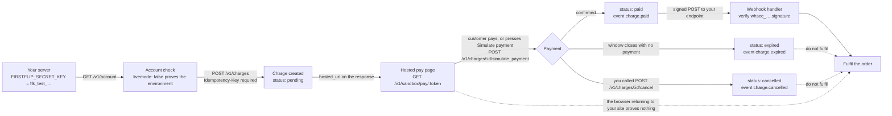

# Quickstart

From a test key to a paid test charge, in five steps. Nothing here moves real money.

## Quick hints

Short points that matter more than the paragraphs below them.

1. **Confirm the key before you build anything.** `GET /v1/account` answers with `livemode: false` and the last characters of the key — one call that rules out a wrong environment.
2. **The key is shown once and lives on your server only.** Save `ffk_test_…` the moment it arrives; never put it in a browser bundle, a mobile app, or a chat window.
3. **`amount` is in major units.** `32000` is ₦32,000, not 32,000,000 kobo. Minor units is the one mistake that makes a charge 100× too big.
4. **Charge what `payment.asset_amount` says, on `payment.network`.** That figure already includes the service fee; a payment on another network **can lose the funds**.
5. **A test-mode address starts with `TEST-`.** Never send real value to it — and never let a customer's payment page show a production-looking number from a test charge.
6. **The charge exists before the page opens.** `POST /v1/charges` created it; `hosted_url` is only where the customer pays — and in test mode, where the **Simulate payment** button is.
7. **The simulate call needs its own `Idempotency-Key`.** So does the create. A retry without a key is how one order becomes two charges.
8. **Fulfil from `charge.paid`, never from the browser returning.** Webhook or `GET /v1/charges/:id` — the customer's redirect proves nothing.
9. **During the beta we register your webhook.** Send a public `https` URL and we return its `whsec_…` signing secret privately; verify every delivery before you act on it.
10. **The Node SDK has a typed method for all 53 API-key operations**, the 11 [virtual-card](cards.md) routes included — REST and the [agent tools](agents.md) are the same contract underneath.

## The whole flow, end to end

Every step below is an operation in the contract. Read it left to right: the five numbered sections under it
are the same path expanded.



`pending` is the only state a fresh charge can hold, and `paid`, `expired` and `cancelled` are the only ways
out of it — those four values are the whole of `Charge.status`. Three of the four arrows out of the pay page
end in a terminal state that fires an event, which is why the webhook is the fulfilment trigger and not the
redirect.

## 1. Get a test key

During the beta, FirstFlip issues your test key: ask us and we send it over a private channel. (A
Developer screen in the app is coming.) Save the key (`ffk_test_…`) as soon as you receive it; for your
security it is shown only once. Keep it on your server, never in a browser or app.

```bash
export FIRSTFLIP_SECRET_KEY=ffk_test_...
```

## 2. Check the key

```bash
curl https://api.firstflip.ng/v1/account -H "Authorization: Bearer $FIRSTFLIP_SECRET_KEY"
```

```json
{ "object": "account", "business_name": "Acme Stores", "livemode": false, "key": "ffk_test_…9f3a" }
```

## 3. Create a charge

```bash
curl https://api.firstflip.ng/v1/charges \
  -H "Authorization: Bearer $FIRSTFLIP_SECRET_KEY" \
  -H "Idempotency-Key: $(uuidgen)" \
  -H "Content-Type: application/json" \
  -d '{
        "amount": 32000,
        "currency": "NGN",
        "pay_asset": "USDT",
        "reference": "order_1042",
        "customer": { "email": "ada@example.com" }
      }'
```

The response is a [charge](charges.md). The important fields:

- `payment.asset_amount`: what the customer must send (service fee included), e.g. `22.5` USDT.
- `payment.address`: where to send it. In test mode it starts with `TEST-`; never send real funds to it.
- `hosted_url`: our payment page. Redirect your customer here.

## 4. Pay it (simulated)

Open `hosted_url` and press **Simulate payment**, or:

```bash
curl -X POST https://api.firstflip.ng/v1/charges/ch_test_.../simulate_payment \
  -H "Authorization: Bearer $FIRSTFLIP_SECRET_KEY" \
  -H "Idempotency-Key: $(uuidgen)"
```

The charge is now `paid`.

## 5. Receive the webhook

During the beta, send us your public `https` webhook URL; we register it and send you its signing
secret (`whsec_…`) privately. Every paid, cancelled or expired charge is `POST`ed there, signed. See
[Webhooks](webhooks.md) for verification code.

Fulfil orders from the webhook (or by polling `GET /v1/charges/:id`), never from the customer's
browser returning to your site.

## Next

- [Testing](testing.md): the full test checklist before you go live, and how each service is simulated.
- [Postman](../postman/): the same flow with no code. Import both files, set `secretKey`, run
  *Retrieve the account* then *Create a charge*.
- [Node.js SDK](../sdks/node/): a typed method for every API-key operation — **53 of the 53** — with safe
  retries included (copy `sdks/node` into your project; the package is not on npm yet). That includes the 11
  [virtual-card](cards.md) routes, which are `firstflip.cards.*`.
- The same key opens the services: [payouts](payouts.md), [FX](fx.md), [virtual accounts](virtual-accounts.md),
  [verifications](verifications.md) and [one-time passwords](one-time-passwords.md).

## The contract file

The API serves its own contract, so a generator or an agent can read it from the host it is calling instead of
from this repository: `https://api.firstflip.ng/docs/openapi.yaml`, with the service operations at
`https://api.firstflip.ng/docs/api/services.openapi.json`. The service file sits at the path the main spec's
relative `$ref`s already point at, so the fetched YAML resolves with no bundling step. Both answers are cached
for five minutes and revalidate with `ETag`.
