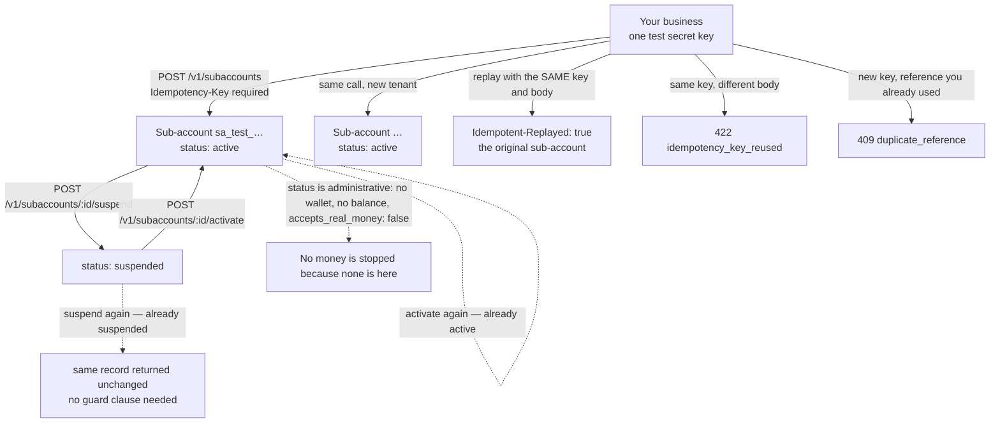

# Sub-accounts

A **sub-account** is one of your own end-users, created under your business with your secret key — the
tenant layer of the Business API. Use it to model your customers and their state (active or suspended)
inside FirstFlip before you wire up live provisioning.

A sub-account is a **sandbox identity**: it has no wallet, holds no balance and cannot receive real money.
Every response says so in `sandbox`. Live provisioning — a real wallet, KYC and settlement per tenant —
is not open yet; until then this endpoint is test mode only, and a live key gets
`403 live_mode_unavailable`.

## Quick hints

Short points that matter more than the paragraphs below them.

1. **A sub-account is a tenant record, not a wallet.** It holds no balance and receives no money — `sandbox.wallet_provisioned: false` and `accepts_real_money: false` say so on every response.
2. **`reference` is your tenant id and it is unique inside your business.** A new `Idempotency-Key` with a `reference` you already used is `409 duplicate_reference`, never a silent second record. Omit it and the sub-account id is used.
3. **The same key replays; a different body under that key is refused.** A retry returns the same sub-account with `Idempotent-Replayed: true`; changing the body is `422 idempotency_key_reused`.
4. **`suspend` and `activate` are idempotent on purpose** — suspending an already suspended tenant returns it unchanged. Your sync job may re-run without a guard clause.
5. **`status` is administrative.** It is your control over your own tenant list; it stops no money, because no money is involved yet.
6. **`tier` is `0` and means nothing today.** Do not build pricing logic on it.
7. **`metadata` values come back as strings**, even the numbers and booleans you sent — same 20-key rule as charges, stored up to 500 characters.
8. **Build against the shape now.** Live provisioning adds a wallet and per-tenant KYC without changing this record shape, so nothing you write here gets thrown away.
9. **Paging is your ownership boundary.** `starting_after` must be one of *your* sub-accounts or the API answers `400 invalid_parameter`; filter with `status` and a half-open `created_from`/`created_before` window.

## The tenant tree and its two states

Your key owns the tree; `reference` is the id you hold for a tenant, and `status` is the only switch in the
record. Both states are drawn with the guards that decide whether a create becomes a record at all.



Read `suspended` as your own flag inside FirstFlip, not as a rail switch. When live provisioning arrives the
record shape is unchanged and `status` starts meaning something to the money path; until then it means
something to *your* sync.

## Create

```bash
curl https://api.firstflip.ng/v1/subaccounts \
  -H "Authorization: Bearer $FIRSTFLIP_SECRET_KEY" \
  -H "Idempotency-Key: $(uuidgen)" \
  -H "Content-Type: application/json" \
  -d '{ "name": "Ada's Store", "email": "ada@example.com", "reference": "tenant_1042", "metadata": { "plan": "starter" } }'
```

```json
{
  "id": "sa_test_2a3b4c5d6e7f80910a1b2c3d",
  "object": "subaccount",
  "livemode": false,
  "reference": "tenant_1042",
  "name": "Ada's Store",
  "email": "ada@example.com",
  "status": "active",
  "tier": 0,
  "metadata": { "plan": "starter" },
  "sandbox": { "wallet_provisioned": false, "accepts_real_money": false },
  "created_at": "2026-11-02T09:15:00.000Z",
  "updated_at": "2026-11-02T09:15:00.000Z"
}
```

| Field | Required | Notes |
|---|---|---|
| `name` | yes | Up to 100 characters. |
| `email` | no | Must be a valid address, up to 254 characters. |
| `reference` | no | An id from your system, up to 100 characters. Unique within your business; if you omit it, the sub-account id is used. |
| `metadata` | no | Same rules as charges: at most 20 keys of 1–40 letters, digits, `_` or `-`; string, number or boolean values, stored as strings up to 500 characters. |

`Idempotency-Key` is required. A retry with the **same** key returns the same sub-account
(`Idempotent-Replayed: true`). A second create with a **new** key and a `reference` you already used is
`409 duplicate_reference` — never a silent duplicate. Reusing a key with a different body is
`422 idempotency_key_reused`.

## Read them back

```bash
curl "https://api.firstflip.ng/v1/subaccounts?status=active&limit=20" -H "Authorization: Bearer $FIRSTFLIP_SECRET_KEY"
curl https://api.firstflip.ng/v1/subaccounts/sa_test_2a3b4c5d6e7f80910a1b2c3d -H "Authorization: Bearer $FIRSTFLIP_SECRET_KEY"
```

Lists are newest first. `limit` is 1–100 (default 20); `has_more` says whether another page follows —
pass the last `id` as `starting_after`. Filter with `status` (`active` or `suspended`) or an exact
`reference`. `starting_after` must be one of your sub-accounts, or the API answers `400 invalid_parameter`.
Add `created_from` (inclusive) / `created_before` (exclusive) to read a period — RFC 3339, a bare date
meaning midnight UTC; consecutive windows never count a sub-account twice.

## Suspend and activate

```bash
curl -X POST https://api.firstflip.ng/v1/subaccounts/sa_test_2a3b4c5d6e7f80910a1b2c3d/suspend \
  -H "Authorization: Bearer $FIRSTFLIP_SECRET_KEY" \
  -H "Idempotency-Key: $(uuidgen)"
```

`POST /v1/subaccounts/:id/activate` reverses it. Both moves are idempotent — suspending an already
suspended sub-account returns it unchanged, so a retried request is never an error. `status` is your own
control over your tenant; it changes nothing about money, because no money is involved.

## Scopes and rate limits

Creating and changing sub-accounts needs `subaccounts:write`; reading needs `subaccounts:read`. Keys
minted before scopes existed carry every scope. Writes are limited to 60 per key per minute and reads to
300 — the same limits as the rest of `/v1` (see [Idempotency & errors](idempotency-and-errors.md)).

## Node.js SDK

```js
const sa = await firstflip.subaccounts.create({ name: "Ada's Store", reference: 'tenant_1042' });
await firstflip.subaccounts.suspend(sa.id);
await firstflip.subaccounts.activate(sa.id);

for await (const tenant of firstflip.subaccounts.listAll({ status: 'active' })) console.log(tenant.id);
```

## What is not built yet

A sub-account cannot hold a wallet or receive money, and there is no per-tenant KYC flow. Live
provisioning arrives with the live rails; the record shape will not change (see
[Going live](going-live.md)).
