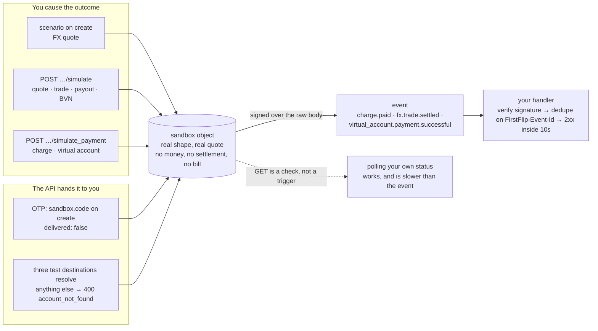

# Testing

## Quick hints

Ranked worst-first. Every one is checkable against this page, the [webhooks guide](webhooks.md), or the spec.

1. **Fulfil from the webhook, never from the redirect.** A customer who pays and closes the tab has still paid;
   a redirect you never receive is the most expensive bug in this list.
2. **The sandbox object is real — only the money is fake.** Quotes carry live rates and the real fee and minimum,
   so a shape bug you find here is a bug you already had.
3. **Three different things produce a sandbox outcome, and only one is a call you make:** `scenario` at create,
   `POST …/simulate`, or a value handed straight back to you (`sandbox.code` on an OTP). Waiting on the wrong
   one makes a passing test look like a hang.
4. **Act on the event, not on the simulate response.** `POST /v1/fx/trades/:id/simulate` answers before
   `fx.trade.settled` reaches your handler; the handler is the truth.
5. **Deduplicate on `FirstFlip-Event-Id`.** A resend is normal, not a bug — and an unguarded handler fulfils
   twice.
6. **Verify the signature before you parse the body.** Recompute HMAC-SHA256 over `"<t>.<raw body>"`, compare in
   constant time, reject a `t` older than 5 minutes.
7. **`429` is a bucket, not a defect.** 300 reads / 60 writes per key per minute in the sandbox and in production,
   so a fan-out test that trips it has measured your concurrency, not the API.
8. **No live rail is called from here.** A green sandbox run proves your code and the contract; it proves nothing
   about a provider's uptime.

## What the sandbox is

Everything you build with a test key (`ffk_test_…`) runs in the **sandbox**:

- Charges are real API objects with real quotes (live rates, the real fee and minimum) but a placeholder
  address that starts with `TEST-`. **Never send real funds to it.** Nothing watches it.
- Payment is simulated: press **Simulate payment** on the hosted page, or call
  `POST /v1/charges/:id/simulate_payment`.
- Webhooks are real, signed requests to your test endpoints.
- No money moves, nothing is settled, nothing is billed.

## Services in the sandbox

The provider-backed services (FX, virtual accounts, verifications, OTPs, payouts) never call a live rail. You drive
each outcome yourself, so every branch your code must handle can be rehearsed:

| Service | How the outcome is produced |
|---|---|
| FX quote | `scenario` on create (`ready`, `processing`, `expired`, `invalid_amount`, `invalid_currency_pair`, `exceeded_limit`), or `POST /v1/fx/quotes/:id/simulate` for a `processing` quote |
| FX trade | `POST /v1/fx/trades/:id/simulate` with `pending`, `settled` or `failed` |
| Virtual account payment | `POST /v1/virtual_accounts/:id/simulate_payment` with `amount` and `reference`; the account's expected amount decides `successful`, `reversed` or `failed` |
| BVN verification | `POST /v1/verifications/bvn/:id/simulate` with `verified`, `declined` or `failed` |
| Bank-account resolution | Three documented test destinations answer; anything else is `400 account_not_found` |
| Payout | `POST /v1/transfers/:id/simulate` with `pending`, `successful` or `failed` |
| OTP | Nothing to simulate: the code is returned on create as `sandbox.code` and `delivered` is `false` |

Every outcome above lands the same way: you cause it, it becomes a real object, and the object emits a signed
event your handler must be able to survive.

The dashed edge is a hint, not a prohibition: you may poll to reconcile, but a design that fulfils only when a
`GET` shows the new state will look correct in the sandbox and fall over the first time a customer's payment
arrives between two polls.

Guides: [FX](fx.md), [virtual accounts](virtual-accounts.md), [verifications](verifications.md),
[one-time passwords](one-time-passwords.md), [payouts](payouts.md).

## Checklist before going live

Run each of these against the sandbox:

- [ ] `GET /v1/account` succeeds from your server, with the key read from an environment variable.
- [ ] Create a charge and redirect to `hosted_url`; simulate payment; your order is fulfilled **from the
      webhook**, not from the customer's redirect.
- [ ] Your webhook handler rejects a request with a wrong or missing `FirstFlip-Signature` (send one with
      `curl` and a made-up header, and expect your 400).
- [ ] Your handler ignores a duplicate: resend the same event (ask FirstFlip during the beta) and
      confirm the order is not fulfilled twice.
- [ ] A cancelled charge (`POST /v1/charges/:id/cancel`) and an expired one (create with
      `expires_in_minutes: 15`, wait, then fetch it) release the order.
- [ ] A network timeout on `POST /v1/charges` is retried with the **same** Idempotency-Key and does not
      create two charges.
- [ ] Creating a second charge with the same `reference` is handled (`409 duplicate_reference`).
- [ ] Your handler returns 2xx in under 10 seconds (queue slow work).
- [ ] Your logs never print the secret key or the webhook secret.
- [ ] A quote goes `processing` → `ready` and a trade reaches `settled`; your handler acts on `fx.trade.settled`,
      not on the `simulate` response.
- [ ] A dynamic virtual account is consumed by its first successful payment and your handler acts on
      `virtual_account.payment.successful`.
- [ ] An OTP validates with the sandbox code, and five wrong attempts lock it.

## Postman

Import `postman/FirstFlip-API.postman_collection.json` and `postman/FirstFlip-Sandbox.postman_environment.json`,
select the *FirstFlip Sandbox* environment, set `secretKey` to your test key, then run *Retrieve the account
for this key* and *Create a charge*. The created charge's id is saved automatically, so *Retrieve a charge*,
*Simulate a payment* and *Cancel a pending charge* work straight after.

The services have their own collection, `api/services.postman_collection.json`, with the same environment: quote →
simulate → trade, a virtual account and its payment, a BVN check, an OTP and a payout batch.
