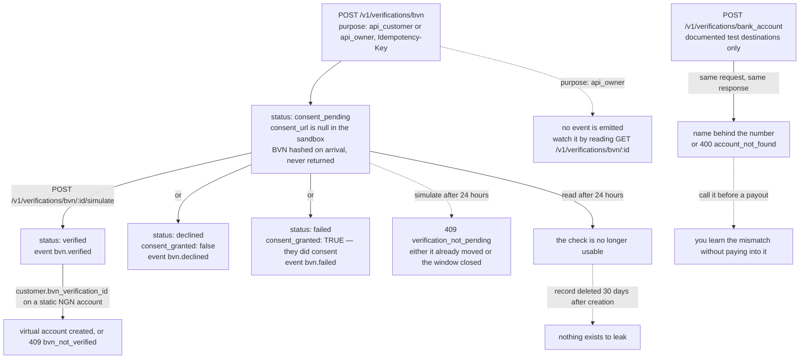

# Verifications (test mode)

Two checks live under `/v1/verifications`: a **BVN consent flow** (start a check, then simulate what the provider
would answer) and **bank-account resolution** (the name behind a payout destination). Both are test-mode only —
nothing here grants real KYC, verifies an identity, or moves money, and a live key gets `403 live_mode_unavailable`.

## Quick hints

Short points that matter more than the paragraphs below them.

1. **A BVN check is a consent flow, not a lookup.** It is created `consent_pending` and resolves later as a status change plus a `bvn.*` event. Code it as asynchronous from the first line.
2. **You never get the BVN back — and you never need to keep it.** It is hashed on arrival, never returned, never logged. Persist the check `id`, nothing else.
3. **`consent_url` is `null` in the sandbox** because there is no hosted consent page here. `simulate` is the entire consent path.
4. **Two clocks, not one.** The check expires **24 hours** after creation; the underlying record is deleted **30 days** after creation. The first is whether you can still use it, the second is how long anything exists to leak.
5. **`failed` still means they consented.** `consent_granted` is `true` on `failed` and `false` on `declined` — so never infer consent from `status` alone.
6. **A `purpose: api_owner` check emits no event.** It is about your own business identity; watch it by reading it back.
7. **`409 verification_not_pending` has two causes** — the check already moved, or its 24 hours ran out. Fetch it and read `status` before deciding what to do.
8. **Nothing here is production evidence.** A simulated result never sets real KYC status and never unlocks a live key, and `account_verified` is always `false`. Do not gate a live feature on a test check.
9. **Bank-name resolution accepts only the three documented test destinations.** Anything else is `400 account_not_found` — the sandbox will not invent a name for a real account number, which is exactly why you should call it before a payout.
10. **A verified, consented, unexpired check can stand in for the identity requirement** on a static NGN [virtual account](virtual-accounts.md) via `customer.bvn_verification_id` — with `first_name`/`last_name` matching, or the account is refused `409 bvn_not_verified`.

## One check, two clocks, and a separate synchronous call

`BvnVerification.status` is `consent_pending`, `verified`, `declined` or `failed`. Bank resolution is not on
that machine at all: it answers in the response and has no status to watch.



The edge worth reading twice is `failed` → `consent_granted: true`. A failed check is not a refusal, so
`status` alone will tell your ops team the wrong story; read the consent flag with it.

## BVN verification

A BVN check is a consent flow, not a lookup. You create the request, the customer consents, and the result arrives
as a status change plus a `bvn.*` webhook event.

```bash
curl https://api.firstflip.ng/v1/verifications/bvn \
  -H "Authorization: Bearer $FIRSTFLIP_SECRET_KEY" \
  -H "Idempotency-Key: $(uuidgen)" \
  -H "Content-Type: application/json" \
  -d '{
        "bvn": "22222222222",
        "first_name": "Ada",
        "last_name": "Obi",
        "redirect_url": "https://example.com/kyc/done"
      }'
```

```json
{
  "id": "bvn_test_…",
  "object": "bvn_verification",
  "livemode": false,
  "purpose": "api_customer",
  "status": "consent_pending",
  "consent_granted": false,
  "verified_at": null,
  "expires_at": "2026-11-05T10:30:00.000Z",
  "consent_url": null,
  "sandbox": { "identity_verified": false, "consent_channel": "email" }
}
```

- `bvn` is an 11-digit string and must not be all zeros. It is hashed on arrival and never stored in the clear,
  never returned, and never logged.
- `first_name` and `last_name` must match the BVN holder; the match is checked against the hashed names later.
- `redirect_url` must be a public HTTPS URL — that is where the customer lands after consent. You never receive the
  BVN back.
- A check expires **24 hours** after creation. The underlying record is removed **30 days** after creation.
- `purpose` is `api_customer` for a check about one of your customers, or `api_owner` for your own business.

### Simulate the provider's answer

There is no hosted consent page in the sandbox, so `consent_url` is `null`; test the decision with `simulate`.

```bash
curl -X POST https://api.firstflip.ng/v1/verifications/bvn/bvn_test_…/simulate \
  -H "Authorization: Bearer $FIRSTFLIP_SECRET_KEY" \
  -H "Idempotency-Key: $(uuidgen)" \
  -H "Content-Type: application/json" \
  -d '{ "outcome": "verified" }'
```

| `outcome` | `status` | `consent_granted` | `verified_at` |
|---|---|---|---|
| `verified` | `verified` | `true` | now |
| `declined` | `declined` | `false` | `null` |
| `failed` | `failed` | `true` | `null` |

- The move is allowed once, and only while the check is `consent_pending` and unexpired. Anything else is
  `409 verification_not_pending`.
- Each outcome emits `bvn.verified`, `bvn.declined` or `bvn.failed`. A check created with `purpose: api_owner` is
  about your own business identity and emits no event.
- A simulated result **never** sets real KYC status or grants a live key. Test identity evidence cannot become
  production evidence.

Read it back with `GET /v1/verifications/bvn/:id` (same shape, without `consent_url`).

### Using the result

A `verified` check can stand in for an identity check when provisioning a **static NGN virtual account**: pass its
id as `customer.bvn_verification_id`, with `first_name` and `last_name` matching the check. The verification must be
`verified`, consented and unexpired, or the account is refused with `409 bvn_not_verified`.

## Bank-account resolution

Resolve a destination name before a payout, so a mistyped number is caught before money is attached to it.

```bash
curl -X POST https://api.firstflip.ng/v1/verifications/bank_account \
  -H "Authorization: Bearer $FIRSTFLIP_SECRET_KEY" \
  -H "Idempotency-Key: $(uuidgen)" \
  -H "Content-Type: application/json" \
  -d '{ "country": "NG", "type": "bank_account", "account_bank": "044", "account_number": "0690000032" }'
```

```json
{
  "object": "bank_account_verification",
  "livemode": false,
  "country": "NG",
  "type": "bank_account",
  "account_bank": "044",
  "account_number": "0690000032",
  "account_name": "FIRSTFLIP TEST CUSTOMER",
  "sandbox": { "account_verified": false }
}
```

`country` defaults to `NG` and `type` to `bank_account`. Supported destinations are NG bank accounts, GH bank
accounts and GH mobile money (`type: mobile_money`).

The sandbox answers **only** these documented test destinations. Anything else is `400 account_not_found` — the
sandbox never invents a name for a real account number:

| `country` | `type` | `account_bank` | `account_number` | `account_name` |
|---|---|---|---|---|
| `NG` | `bank_account` | `044` | `0690000032` | `FIRSTFLIP TEST CUSTOMER` |
| `GH` | `bank_account` | `001` | `0000000001` | `FIRSTFLIP GHANA TEST CUSTOMER` |
| `GH` | `mobile_money` | `MTN` | `233240000001` | `FIRSTFLIP GHANA MOBILE TEST CUSTOMER` |

`account_number` must be 5–20 digits (exactly 10 for NG). `account_verified` is always `false`: the name is a
fixture, not proof of account ownership.

## Retry safely

Every write needs an `Idempotency-Key`. Creating the same check twice with the same key returns the same record;
reusing a key with a different body is `422 idempotency_key_reused`. See
[Idempotency & errors](idempotency-and-errors.md).

## Scopes and rate limits

Creating and simulating a check, and resolving a bank account, need `verifications:write`; reading a check needs
`verifications:read`. Writes are limited to 60 per key per minute and reads to 300.

## Node.js SDK

```js
const check = await firstflip.verifications.createBvn({
  bvn: '22222222222',
  first_name: 'Ada',
  last_name: 'Obi',
  redirect_url: 'https://example.com/kyc/done',
});
console.log(check.status, check.consent_url); // consent_pending null

const done = await firstflip.verifications.simulateBvn(check.id, 'verified');
console.log(done.status, done.verified_at); // verified <timestamp>

const dest = await firstflip.verifications.resolveBank({
  country: 'NG', type: 'bank_account', account_bank: '044', account_number: '0690000032',
});
console.log(dest.account_name); // FIRSTFLIP TEST CUSTOMER
```

`firstflip.verifications.retrieveBvn` reads a check back.
