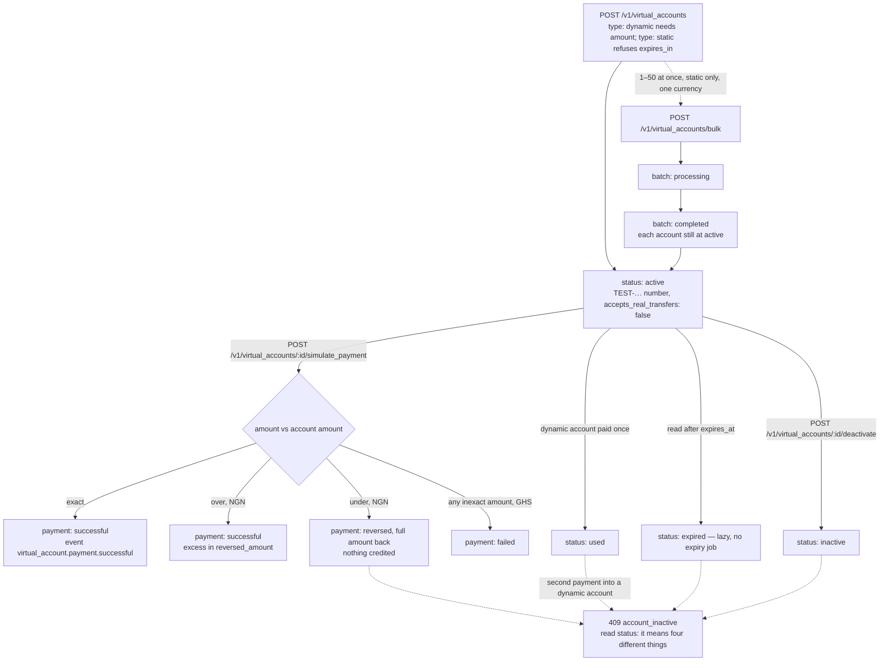

# Virtual accounts (test mode)

`POST /v1/virtual_accounts` provisions a **test** account number for a customer to pay into. A **static** account
is reused for a fixed amount; a **dynamic** account takes one payment and expires. Nothing accepts real money:
every account carries `sandbox.accepts_real_transfers: false`, and the number is a `TEST-…` fixture at
"FirstFlip Sandbox Bank". A live key gets `403 live_mode_unavailable`.

## Quick hints

Short points that matter more than the paragraphs below them.

1. **`dynamic` is one payment, `static` is a reusable number.** `amount` is required on dynamic and `expires_in` is refused on static — pick the type from the payment pattern, not from convenience.
2. **The amount rule is the reconciliation.** Exact → `successful`. Over (NGN) → `successful` with the excess in `reversed_amount`. Under (NGN) → `reversed`, full amount back, nothing credited. In GHS, anything not exact → `failed`. One rule per currency, not one rule for both.
3. **A short payment is not a partial credit.** It reverses in full, so ask the payer to send the exact figure again — do not silently retry the same `reference` and hope it lands.
4. **Store the `id` when you create the account.** This version has no list route for virtual accounts; `reference` defaults to the id and is yours to overwrite.
5. **A static NGN account needs an identity check**: `customer.bvn_verification_id` from a consented, verified [BVN check](verifications.md), or an 11-digit `nin`/`bvn`. The sandbox validates the format and **discards the value** — so never store one you would have to protect.
6. **`409 account_inactive` means four different things** — expired, used, inactive, or a second payment into a dynamic account. Fetch the account and read `status`; the code alone will not tell you.
7. **Expiry is lazy.** A read after `expires_at` returns `expired` and a payment into it is refused; there is no expiry job to watch for a state change.
8. **Bulk is `static` only, one currency, 1–50, and validated before anything is written** — so a bad item fails the batch instead of creating half of it. No per-item `reference`; FirstFlip assigns `<batch id>:<index>`.
9. **Nothing is real here.** Every account carries `sandbox.accepts_real_transfers: false` and every payment `sandbox.wallet_credited: false`. Tell your own ops team before anyone wires money to a `TEST-…` number.
10. **`narration` (35 characters) is what the payer sees** on their bank statement line — it is customer-facing copy, not an internal tag. Use `reference` for that.

## How an account is used up

One account can be paid into once (dynamic) or repeatedly (static), and the amount rule differs per
currency. `status` has four values — `active`, `inactive`, `expired`, `used` — and a payment has three
outcomes — `successful`, `failed`, `reversed`.



The four dashed arrows into `409 account_inactive` are the trap this shape exists to draw: the code is the
same and the repair is not, so fetch `GET /v1/virtual_accounts/:id` and branch on `status`.

## One account

```bash
curl https://api.firstflip.ng/v1/virtual_accounts \
  -H "Authorization: Bearer $FIRSTFLIP_SECRET_KEY" \
  -H "Idempotency-Key: $(uuidgen)" \
  -H "Content-Type: application/json" \
  -d '{
        "currency": "NGN",
        "type": "dynamic",
        "amount": 5000,
        "customer": { "email": "ada@example.com", "first_name": "Ada", "last_name": "Obi" },
        "narration": "Order 1042"
      }'
```

```json
{
  "id": "va_test_5f3c1a9d2e7b4c6081a2b3c4",
  "object": "virtual_account",
  "livemode": false,
  "reference": "va_test_5f3c1a9d2e7b4c6081a2b3c4",
  "currency": "NGN",
  "type": "dynamic",
  "status": "active",
  "amount": 5000,
  "account_number": "TEST-NGN-2e7b4c6081a2",
  "bank_name": "FirstFlip Sandbox Bank",
  "narration": "Order 1042",
  "expires_at": "2026-11-04T11:30:00.000Z",
  "created_at": "2026-11-04T10:30:00.000Z",
  "sandbox": { "accepts_real_transfers": false }
}
```

`account_number` is `TEST-<currency>-` plus the last 12 characters of the account id. `status` is one of
`active`, `inactive`, `expired`, `used`.

### Static or dynamic

| | `static` | `dynamic` |
|---|---|---|
| `amount` | Optional; a fixed expected amount | **Required** |
| `expires_in` | Not accepted (`400 invalid_parameter`) | 1–1440 minutes, default 60 |
| After a successful payment | Stays `active` | Becomes `used` |
| After `expires_at` | Reads as `expired` | Reads as `expired` |

`currency` is `NGN` or `GHS` (default `NGN`) and `type` defaults to `dynamic`.

- `customer` is required on every account: a valid `email`, plus `first_name` and `last_name`.
- A **static NGN** account needs an identity check: either `customer.bvn_verification_id` from a consented,
  verified [BVN check](verifications.md), or an 11-digit `customer.nin` (an 11-digit `customer.bvn` is accepted the
  same way). The sandbox validates the format and then discards the value — nothing is stored.
- `amount` is in major units, positive, at most two decimal places.
- `reference` (max 100) defaults to the account id; `narration` (max 35) is what the payer sees.

## Simulate a payment

```bash
curl -X POST https://api.firstflip.ng/v1/virtual_accounts/va_test_5f3c1a9d2e7b4c6081a2b3c4/simulate_payment \
  -H "Authorization: Bearer $FIRSTFLIP_SECRET_KEY" \
  -H "Idempotency-Key: $(uuidgen)" \
  -H "Content-Type: application/json" \
  -d '{ "amount": 5000, "reference": "bank-ref-88213" }'
```

```json
{
  "id": "vap_test_a1b2c3d4e5f60718293a4b5c",
  "object": "virtual_account_payment",
  "livemode": false,
  "virtual_account_id": "va_test_5f3c1a9d2e7b4c6081a2b3c4",
  "reference": "bank-ref-88213",
  "session_id": "TEST-SESSION-vap_test_a1b2c3d4e5f60718293a4b5c",
  "currency": "NGN",
  "amount": 5000,
  "credited_amount": 5000,
  "reversed_amount": 0,
  "status": "successful",
  "sandbox": { "wallet_credited": false },
  "created_at": "2026-11-04T10:35:00.000Z"
}
```

The outcome depends on the amount against the account's expected amount:

| Paid | `status` | `credited_amount` | `reversed_amount` |
|---|---|---|---|
| Equal to the expected amount, or any amount into a static account with no `amount` | `successful` | the amount | `0` |
| More than the expected amount (NGN) | `successful` | the expected amount | the excess |
| Less than the expected amount (NGN) | `reversed` | `0` | the full amount |
| Not equal to the expected amount (GHS) | `failed` | `0` | `0` |

Each result emits `virtual_account.payment.successful`, `.failed` or `.reversed` to your webhook endpoints. No
wallet is credited anywhere in the sandbox (`sandbox.wallet_credited: false`).

- `reference` is required and identifies the payer's transfer; it is echoed back for reconciliation.
- A dynamic account is consumed by its first **successful** payment. A second payment, or any payment into an
  account that is `inactive`, `expired` or `used`, is `409 account_inactive`.
- Reusing an `Idempotency-Key` with a different body (or against another account) is `422
  idempotency_key_reused`. Replaying the same request returns the same receipt.

## Bulk accounts

`POST /v1/virtual_accounts/bulk` provisions 1 to 50 **static** accounts in one call, all in one currency.

```bash
curl https://api.firstflip.ng/v1/virtual_accounts/bulk \
  -H "Authorization: Bearer $FIRSTFLIP_SECRET_KEY" \
  -H "Idempotency-Key: $(uuidgen)" \
  -H "Content-Type: application/json" \
  -d '{
        "accounts": [
          { "customer": { "email": "ada@example.com", "first_name": "Ada", "last_name": "Obi", "nin": "12345678901" } },
          { "customer": { "email": "sam@example.com", "first_name": "Sam", "last_name": "Eze", "nin": "12345678902" } }
        ]
      }'
```

```json
{
  "id": "vab_test_7c8d9e0f1a2b3c4d5e6f7081",
  "object": "virtual_account_batch",
  "livemode": false,
  "status": "completed",
  "currency": "NGN",
  "count": 2,
  "data": [
    { "id": "va_test_1a2b3c4d5e6f708192a3b4c5", "reference": "vab_test_7c8d9e0f1a2b3c4d5e6f7081:0", "object": "virtual_account" },
    { "id": "va_test_2b3c4d5e6f708192a3b4c5d6", "reference": "vab_test_7c8d9e0f1a2b3c4d5e6f7081:1", "object": "virtual_account" }
  ]
}
```

- The whole batch is validated before anything is written.
- Every item must be `static`, share one currency (set it once at the top, or on each item — not both differently),
  and **must not** carry its own `reference`: FirstFlip assigns `<batch id>:<index>`.
- `status: completed` means the accounts exist; they are live numbers you can simulate payments against.
- Read the batch back with `GET /v1/virtual_accounts/bulk/:id`.

## Lifetime and reads

```bash
curl -X POST https://api.firstflip.ng/v1/virtual_accounts/va_test_5f3c1a9d2e7b4c6081a2b3c4/deactivate \
  -H "Authorization: Bearer $FIRSTFLIP_SECRET_KEY" \
  -H "Idempotency-Key: $(uuidgen)"
```

- `deactivate` moves `active` to `inactive`, once. Anything else is `409 account_inactive`.
- Expiry is lazy: a read after `expires_at` returns `expired`, and a payment into it is refused.
- `GET /v1/virtual_accounts/:id` returns the same object shown above.
- There is no list route for virtual accounts in this version; store the `id` (or your `reference`) when you
  create one.

## Retry safely

Every write needs an `Idempotency-Key`. Use **one key for the whole bulk call**: a retry returns the same batch and
the same accounts. Reusing a key with a different body is `422 idempotency_key_reused`. See
[Idempotency & errors](idempotency-and-errors.md).

## Scopes and rate limits

Creating, deactivating and simulating need `virtual_accounts:write`; reads need `virtual_accounts:read`. Writes are
limited to 60 per key per minute and reads to 300.

## Node.js SDK

```js
const account = await firstflip.virtualAccounts.create({
  currency: 'NGN',
  type: 'dynamic',
  amount: 5000,
  customer: { email: 'ada@example.com', first_name: 'Ada', last_name: 'Obi' },
  narration: 'Order 1042',
});

const receipt = await firstflip.virtualAccounts.simulatePayment(account.id, {
  amount: 5000,
  reference: 'bank-ref-88213',
}, { idempotencyKey: 'va-payment-88213' });
console.log(receipt.status, receipt.credited_amount); // successful 5000

const batch = await firstflip.virtualAccounts.createBatch([
  { customer: { email: 'ada@example.com', first_name: 'Ada', last_name: 'Obi', nin: '12345678901' } },
  { customer: { email: 'sam@example.com', first_name: 'Sam', last_name: 'Eze', nin: '12345678902' } },
], { idempotencyKey: 'customer-accounts-nov' });
for (const va of batch.data) console.log(va.id, va.account_number);
```

`firstflip.virtualAccounts.retrieve`, `.retrieveBatch` and `.deactivate` mirror the calls above.
