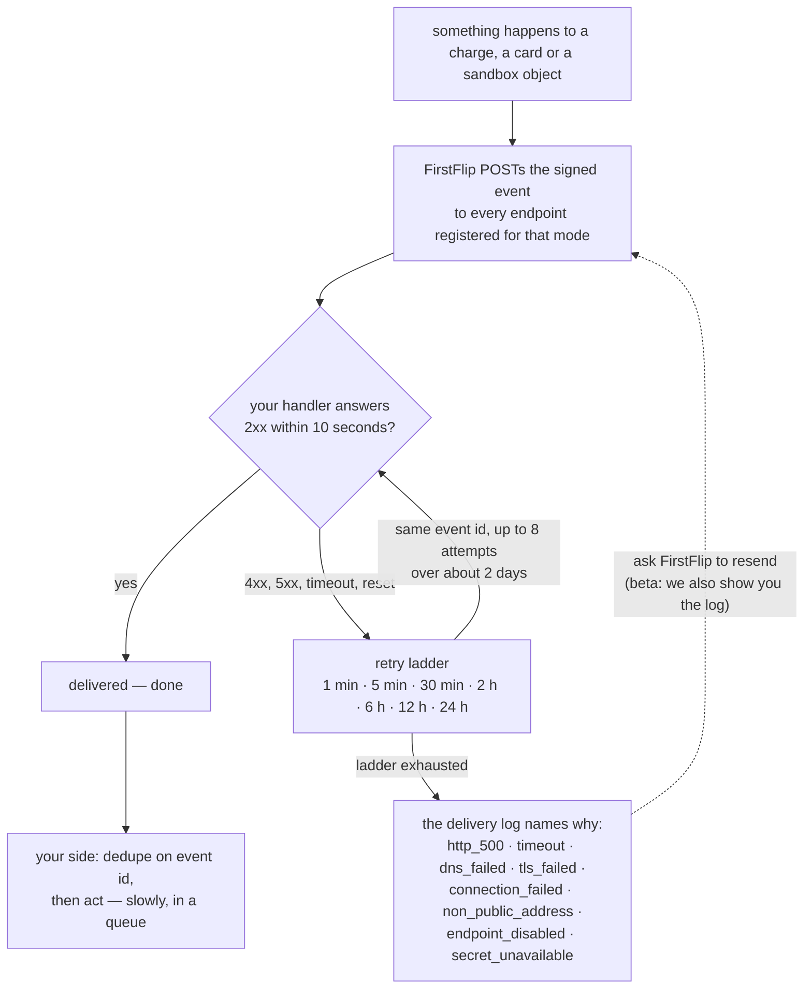

# Webhooks

When something happens to a charge, a card or one of the sandbox services, FirstFlip `POST`s an **event**
to each webhook endpoint you added for that mode (test events go to test endpoints, live to live).

## Quick hints

1. **Verify the bytes, then parse.** The signature covers the raw body; parsing and re-serialising it — or
   letting a framework re-encode it — breaks the check even on a genuine delivery.
2. **A `2xx` inside 10 seconds is the entire job.** Anything slower, any error status, any timeout is a
   failed attempt, and the retry ladder is the only repair: 8 attempts over about 2 days.
3. **The same event can arrive twice, and out of order.** Store `event.id` and ignore repeats; where order
   matters, re-read the object and trust its `status` rather than the sequence of deliveries.
4. **A card decline is an event, not an error.** `simulate_authorization` answers `201` whether the swipe was
   approved or refused, so a handler that only watches HTTP statuses never sees the refusal.
5. **`livemode` is `false` in every event today** — the contract publishes it as a constant. Branch on it if
   you like, but do not wait for a live event to make the branch interesting: cards and the services sandbox
   emit test events only, because those surfaces are test-only.
6. **Every event body is described by the contract.** `data.object` is a union of 8 schemas and each of the 28
   published types resolves into exactly one of them — the 9 `card.*` ones included. Lifecycle events carry the
   `card`; money and authorization events carry the `card_transaction`. See
   [What a card event carries](#what-a-card-event-carries).
7. **The endpoint rules are hard refusals, not preferences:** `https` on port 443, a public host, no
   credentials in the URL, at most 5 endpoints per mode, each secret shown once.
8. **Rotating a secret is add-then-delete, never edit.** Add the new endpoint, deploy its secret, verify
   deliveries, then remove the old endpoint — there is no in-place rotation, so a mistaken delete does not
   break a live handler.

## Events

| Type | When | What to do |
|---|---|---|
| `charge.paid` | The customer paid in full | Fulfil the order |
| `charge.cancelled` | You cancelled a pending charge | Release any hold |
| `charge.expired` | A pending charge passed `expires_at` unpaid | Release any hold; create a new charge if the customer returns |

`charge.expired` is sent within about a minute of `expires_at` (and at once if the charge is read after
it expires). If you need a hard cut-off, check `expires_at` yourself.

## Events from the services sandbox

The services sandbox (payouts, FX, virtual accounts, BVN) is test mode only and emits the same kind of
event:

| Type | When |
|---|---|
| `transfer.pending`, `transfer.successful`, `transfer.failed` | You [simulated a transfer](payouts.md#simulate-the-result) into that state |
| `fx.quote.processing`, `fx.quote.ready`, `fx.quote.expired`, `fx.quote.failed` | A quote changes state, or an unpaid quote passes its expiry |
| `fx.trade.pending`, `fx.trade.settled`, `fx.trade.failed` | A trade changes state |
| `virtual_account.payment.successful`, `virtual_account.payment.failed`, `virtual_account.payment.reversed` | A simulated payment into a virtual account changes state |
| `bvn.verified`, `bvn.declined`, `bvn.failed` | A BVN verification resolves |

`data.object` is the object that changed (`transfer`, `fx_quote`, `fx_trade`, `virtual_account_payment`
or `bvn_verification`). Signature, headers, retries and deduplication are the same as for charge events.

## Events from virtual cards (test mode)

The sandbox card surface emits nine events. All of them are test-mode events — there are no live card
events, because there are no live cards (see [Virtual cards](cards.md)).

| Type | `data.object` | When |
|---|---|---|
| `card.created` | `card` | A card was issued with `POST /v1/cards` |
| `card.funded` | `card_transaction` | `fund` moved money onto the card, so `amount` and `balance_after` are in the event |
| `card.withdrawn` | `card_transaction` | `withdraw` moved money off the card — same payload shape as `card.funded` |
| `card.frozen` | `card` | The card moved to `frozen` (`freeze`, or a freeze you simulate) |
| `card.unfrozen` | `card` | A frozen card moved back to `active` (`unfreeze`) |
| `card.closed` | `card` | The card moved to `closed` (`close`) — terminal, no event can undo it |
| `card.limits.updated` | `card` | `spend_limits` changed the daily, per-transaction or monthly cap |
| `card.authorization.approved` | `card_transaction` | A simulated authorization passed every rule |
| `card.authorization.declined` | `card_transaction` | A simulated authorization was refused — read `decline_code` for which rule fired |

Signature, headers, retries and deduplication are identical to the events above: verify
`FirstFlip-Signature` over the raw body, deduplicate on `FirstFlip-Event-Id`, answer `2xx` fast.

**A decline arrives as an event, not as an error.** `simulate_authorization` answers `201` whether the
authorization was approved or declined, so an integration that only watches HTTP statuses never sees the
decline at all. Handle `card.authorization.declined`, or read `status` and `decline_code` off the
transaction.

### What a card event carries

`data.object` is the object itself, built by the same serializer that answers `GET /v1/cards/{id}` and
`GET /v1/cards/{id}/transactions`. A `card.*` delivery therefore validates against the schema the reference
already publishes: `card` for the five lifecycle types, `card_transaction` for the four money and
authorization types — the same fields, the same ids, no extra wrapper.

Two consequences, worth knowing before the handler is written:

1. **A fund or a withdrawal is its own ledger row.** `card.funded` and `card.withdrawn` carry the row the
   call returned, so `amount`, `balance_before`, `balance_after` and, for a decline, `decline_code` are
   already in the body. The row is the record; the delivery is the notice that it exists.
2. **`created_at` is when the change happened, not when the delivery landed.** An event the platform could
   not record first time is re-driven later under the same `event.id`, keeping its original `created_at` —
   and the object it carries is the row as it stands when the event is finally recorded. So a late
   `card.frozen` can describe a card that has since been unfrozen. Where current state matters, re-read the
   card and trust its `status`.

Deduplication stays your job either way: deliveries are at-least-once, so the same `event.id` can arrive
twice, and out of order.

## The request

```http
POST /your/webhook/path HTTP/1.1
Content-Type: application/json
User-Agent: FirstFlip-Webhooks/1.0
FirstFlip-Event-Id: evt_3b1f0c9a8e7d6c5b4a392817
FirstFlip-Event-Type: charge.paid
FirstFlip-Signature: t=1790000000,v1=5257a869e7ecebeda32affa62cdca3fa51cad7e77a0e56ff536d0ce8e108d8bd

{"id":"evt_3b1f0c9a8e7d6c5b4a392817","object":"event","type":"charge.paid","livemode":false,
 "created_at":"2026-09-28T12:04:11.000Z","data":{"object":{ …the charge… }}}
```

`data.object` is the full [charge](charges.md) as it was when the event happened.

## Verify every request

The signature proves the request came from FirstFlip and was not changed or replayed.

1. Read the **raw** request body. Do not parse and re-serialise it; any byte change breaks the signature.
2. From `FirstFlip-Signature`, take `t` (unix seconds) and `v1` (hex).
3. Compute `HMAC-SHA256(key = your endpoint secret, message = t + "." + raw body)`, hex-encoded.
4. Compare it with `v1` in constant time.
5. Reject if `t` is more than 5 minutes from your clock (replay protection).

Three implementations of exactly those five steps. Open the one you run — they are equivalent, and none of
them is longer than the rule above.

<details>
<summary><strong>Node.js (Express)</strong> — the verifier and the one raw-body route that uses it.</summary>

```js
const crypto = require('node:crypto');
const express = require('express');
const app = express();

function verifyFirstFlip(secret, rawBody, header, toleranceSec = 300) {
  const parts = Object.fromEntries(String(header || '').split(',').map((p) => p.split('=')));
  const t = Number(parts.t);
  if (!Number.isInteger(t) || !parts.v1) return false;
  if (Math.abs(Math.floor(Date.now() / 1000) - t) > toleranceSec) return false;
  const expected = crypto.createHmac('sha256', secret).update(`${t}.${rawBody}`).digest('hex');
  const a = Buffer.from(expected, 'hex');
  const b = Buffer.from(parts.v1, 'hex');
  return a.length === b.length && crypto.timingSafeEqual(a, b);
}

// express.raw keeps the exact bytes for this route only.
app.post('/webhooks/firstflip', express.raw({ type: 'application/json' }), (req, res) => {
  const raw = req.body.toString('utf8');
  if (!verifyFirstFlip(process.env.FIRSTFLIP_WEBHOOK_SECRET, raw, req.get('FirstFlip-Signature'))) {
    return res.sendStatus(400);
  }
  const event = JSON.parse(raw);
  // Dedupe on event.id, then act. Respond fast; do slow work in a queue.
  if (event.type === 'charge.paid') { /* fulfil event.data.object.reference */ }
  res.sendStatus(200);
});
```

</details>

<details>
<summary><strong>Python (Flask)</strong> — the same five steps, with <code>request.get_data()</code> for the exact bytes.</summary>

```python
import hashlib, hmac, os, time
from flask import Flask, request, abort

app = Flask(__name__)

def verify_firstflip(secret: str, raw_body: bytes, header: str, tolerance: int = 300) -> bool:
    try:
        parts = dict(p.split("=", 1) for p in (header or "").split(","))
        t = int(parts["t"])
        v1 = parts["v1"]
    except (KeyError, ValueError):
        return False
    if abs(int(time.time()) - t) > tolerance:
        return False
    expected = hmac.new(secret.encode(), f"{t}.".encode() + raw_body, hashlib.sha256).hexdigest()
    return hmac.compare_digest(expected, v1)

@app.post("/webhooks/firstflip")
def firstflip_webhook():
    raw = request.get_data()  # exact bytes
    if not verify_firstflip(os.environ["FIRSTFLIP_WEBHOOK_SECRET"], raw, request.headers.get("FirstFlip-Signature", "")):
        abort(400)
    event = request.get_json()
    if event["type"] == "charge.paid":
        pass  # fulfil event["data"]["object"]["reference"]
    return "", 200
```

</details>

<details>
<summary><strong>PHP</strong> — <code>php://input</code> plus <code>hash_equals</code>, no framework needed.</summary>

```php
<?php
function verify_firstflip(string $secret, string $rawBody, string $header, int $tolerance = 300): bool {
    $parts = [];
    foreach (explode(',', $header) as $p) {
        [$k, $v] = array_pad(explode('=', $p, 2), 2, null);
        $parts[$k] = $v;
    }
    if (!isset($parts['t'], $parts['v1']) || !ctype_digit($parts['t'])) return false;
    $t = (int) $parts['t'];
    if (abs(time() - $t) > $tolerance) return false;
    $expected = hash_hmac('sha256', $t . '.' . $rawBody, $secret);
    return hash_equals($expected, $parts['v1']);
}

$raw = file_get_contents('php://input');
if (!verify_firstflip(getenv('FIRSTFLIP_WEBHOOK_SECRET'), $raw, $_SERVER['HTTP_FIRSTFLIP_SIGNATURE'] ?? '')) {
    http_response_code(400);
    exit;
}
$event = json_decode($raw, true);
http_response_code(200);
```

</details>

## Respond, retries, duplicates



- Return any **2xx within 10 seconds**. Anything else (or a timeout) is a failed attempt.
- Failed attempts are retried after 1 min, 5 min, 30 min, 2 h, 6 h, 12 h and 24 h (8 attempts over
  about 2 days). During the beta, ask FirstFlip to resend an event or show the delivery log.
- Delivery is **at least once**: the same event can arrive more than once. Store `event.id` and ignore
  repeats.
- Events can arrive **out of order**. If order matters, fetch the charge (`GET /v1/charges/:id`) and
  trust its `status`.
- Redirects are not followed. Point the endpoint at the final URL.
- Only your status code matters; we don't read the response body.
- The delivery log shows why an attempt failed: `http_<status>`, `timeout`, `dns_failed`, `tls_failed`,
  `connection_failed`, `non_public_address`, `endpoint_disabled`, or `secret_unavailable` (a fault on
  our side; the attempt is retried).

## Endpoint rules

- `https` on the standard port (443), a public host (no `localhost`, private or internal addresses), no
  credentials in the URL.
- Up to 5 endpoints per mode. Each has its own secret, shown only once. To rotate, add a new endpoint,
  deploy its secret, then delete the old one.
- During the beta, send us your URL: we register the endpoint and send you its secret privately. To
  rotate, send us the new URL, deploy its secret, then ask us to remove the old endpoint.

To test locally, expose your machine with a tunnel and send us the https URL it gives you to register
as a **test** endpoint.
