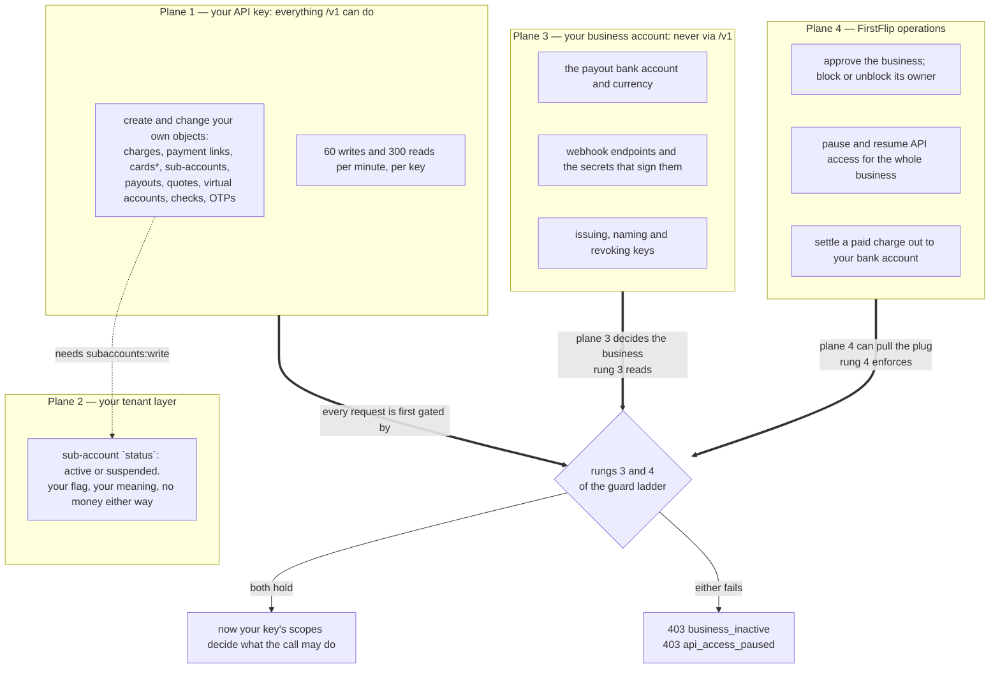

# Who controls what

Four planes can change the state of a FirstFlip integration, and only one of them is the API. Most confusion in a
support thread is one team reaching for the wrong plane — trying to rotate a key with a key, or waiting for a
webhook to tell them why every call suddenly answers `403`.

## Quick hints

1. **`GET /v1/account` is the only thing the API says about your business, and it is read-only.** It returns `business_name`, `livemode` and the masked key. There is no endpoint that changes your payout bank account, your webhook endpoints or your keys.
2. **`403 business_inactive` and `403 api_access_paused` are not your code.** Both are decisions made above your key, on rungs 3 and 4 of the ladder, and no change you push can clear them. Ask us.
3. **Suspending a sub-account moves no money.** `status` is your own flag over your own tenant list — it is not a FirstFlip restriction and it does not freeze a balance.
4. **A key cannot widen itself.** Scopes are fixed at creation, so the fix for `insufficient_scope` is a different key, never a different request.
5. **Nobody can read a key back, including us.** We store a one-way hash. A "lost" key is a new key, and any FirstFlip staff member who could show it to you would have broken the design.
6. **Which card legs you can run live is our decision, not yours.** A live key already runs `list`, `get`, `freeze` and `unfreeze`. The money legs answer `403 live_precondition_unmet` naming the rail that is missing, and there is no switch, no waitlist and no request shape that changes that. [Going live](going-live.md) says why.
7. **Tenancy is absolute and silent.** Another business's id, or your own id under the other mode's key, is a `404`. There is no error that admits the object exists somewhere else.
8. **Two card ceilings are ours, not yours.** A key holds 250 open cards, and a business commits $1,000,000 of approved card spend per rolling 30 days. No API call raises either number — the answers are `409 card_limit_reached` and `decline_code: over_tenant_monthly_limit`. What you control is the count under them: closing a card frees its slot, and the spend window rolls on its own.

## The four planes

\* cards are test-mode only.

## Where each thing actually changes

| You want to | Which plane | How |
|---|---|---|
| Take a payment | 1 | `POST /v1/charges`, then `hosted_url`. [Charges](charges.md) |
| Stop a payment link | 1 | `POST /v1/payment_links/:id/deactivate`. [Payment links](payment-links.md) |
| Model your own customers | 1–2 | `POST /v1/subaccounts` and its suspend/activate. [Sub-accounts](subaccounts.md) |
| Move money onto a sandbox card | 1 | `POST /v1/cards/:id/fund`. [Cards](cards.md) |
| Change where your settled money lands | 3 | Not an API call. Your business account's payout details. |
| Start receiving webhooks | 3 | Register the endpoint with us; the secret comes with it. [Webhooks](webhooks.md) |
| Rotate a leaked key | 3 | Ask us for a new key and revoke the old one. [Authentication](authentication.md) |
| Get un-blocked after a `403 business_inactive` | 4 | Ask us — the business or its owner is what changed, not your request. |
| Settle real money to a bank account | 4 | Only after live mode opens for a verified business. |

## What no plane can do

These are absences by design, and they are the reason a leaked key is survivable:

- **No plane shows a key again after it was issued.** Hash-only storage.
- **No API call changes your payout bank account, your webhook endpoints or your key list.** They are outside `/v1`
  on purpose: a stolen key cannot redirect your settlements, and it cannot mint itself a second key.
- **No key acts outside its mode and its business.** Test and live data never share a namespace, and neither do two
  businesses.
- **No request reaches the resource before rungs 1–8 are answered**, so a `403` never leaks existence. The full
  ordering is in [Authentication](authentication.md).
- **No call raises the two card ceilings.** 250 open cards per key and $1,000,000 of approved spend per business per
  rolling 30 days are set in our code, not in your request body — they are the reason this surface can be opened up
  later without changing what you already see. [Cards](cards.md) has both tables.
- **No card route moves live money**, at any scope, from any key, under any configuration. The legs a live key can
  run today read a card or change its state; every leg that would move money is refused before it reads a balance.

## Reading this back from the API

`GET /v1/account` is the one call that tells you which business and which mode you are actually standing in — run
it whenever a `403` arrives and your code believes its own configuration more than the server does.
